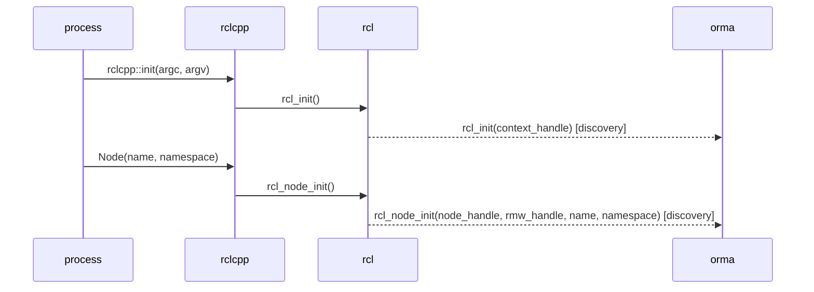
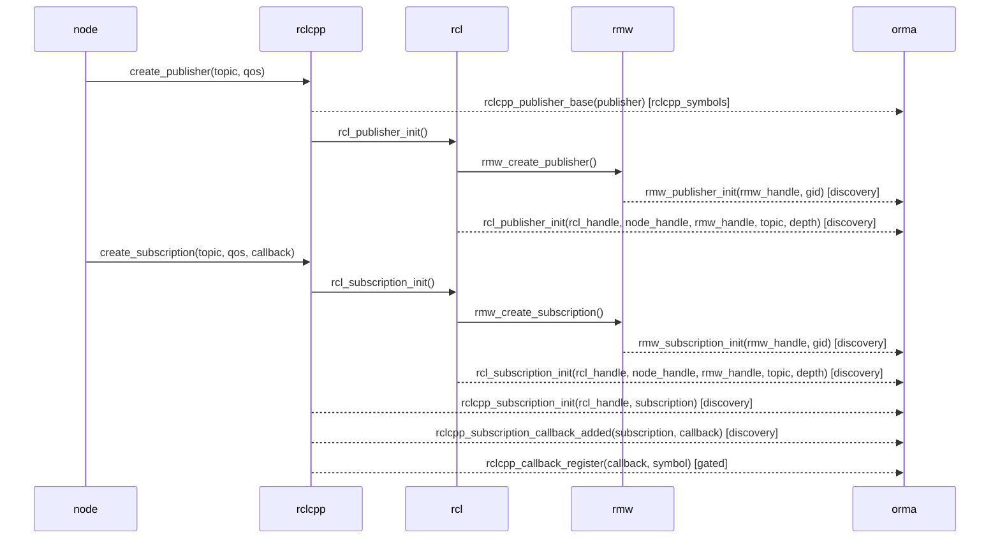
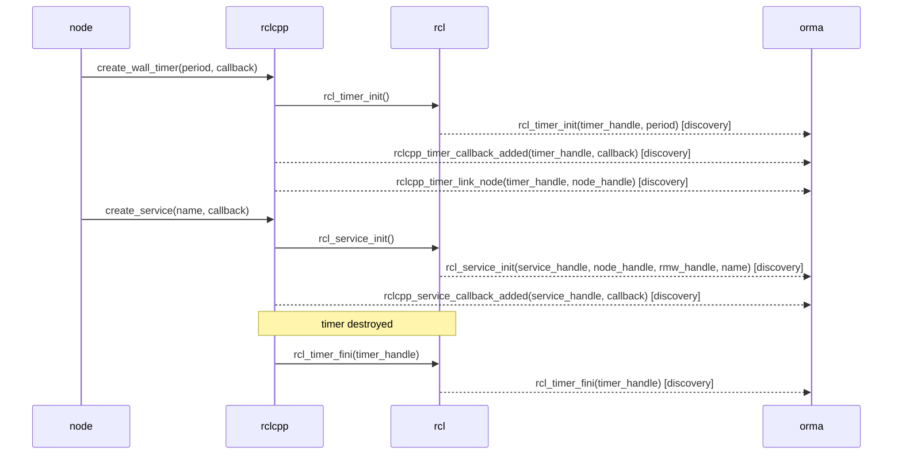
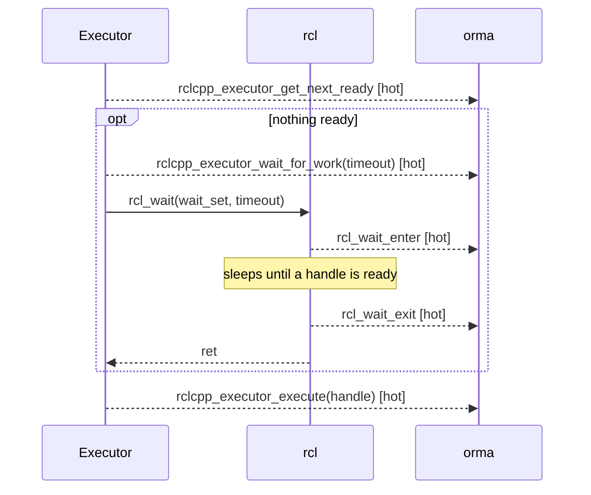
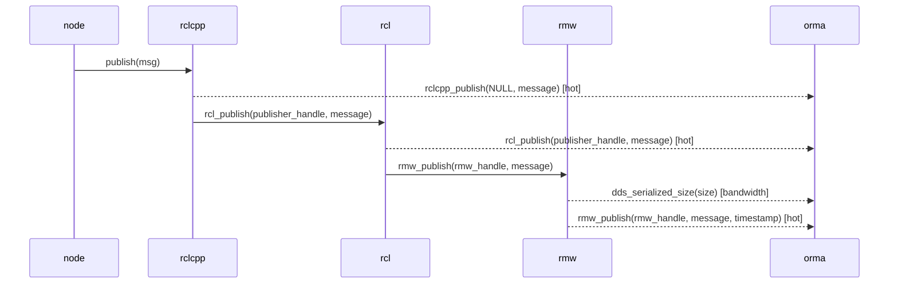
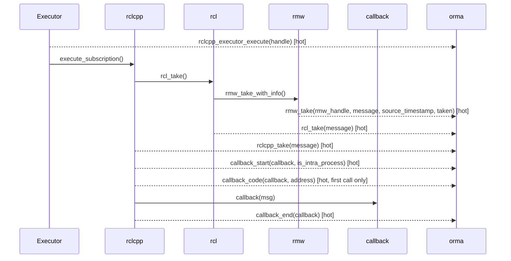
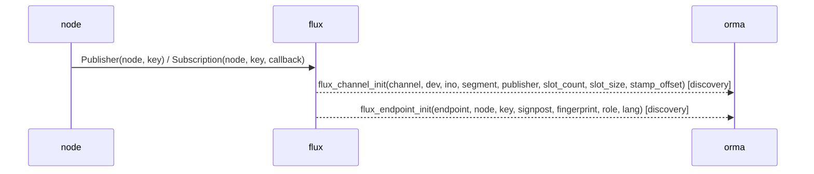
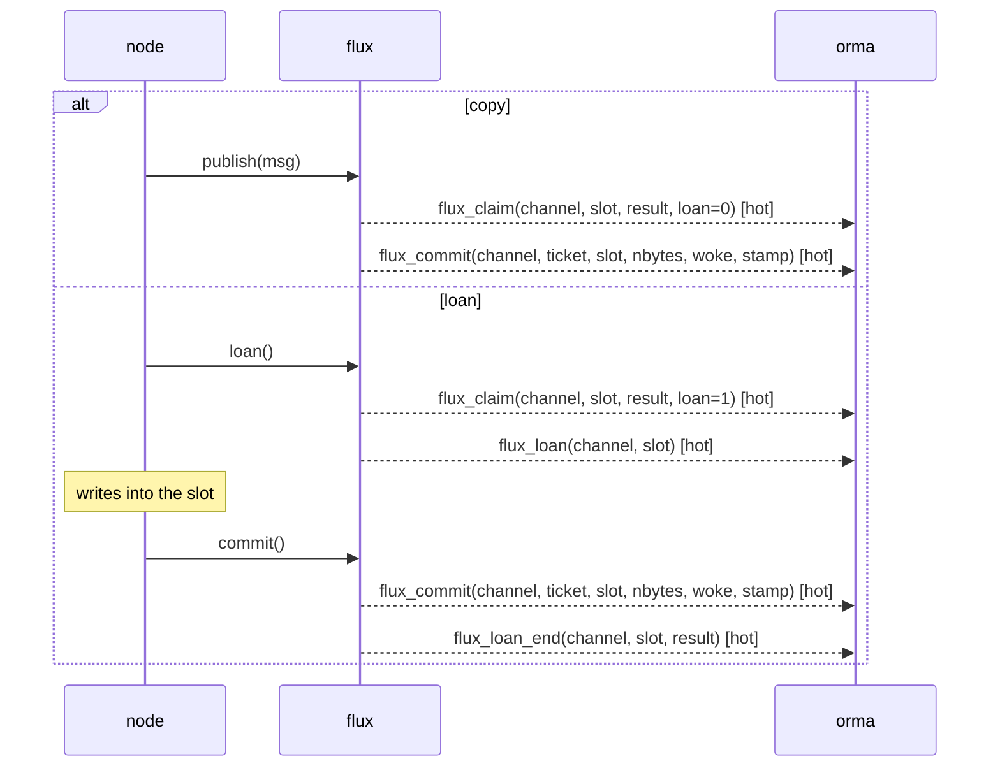
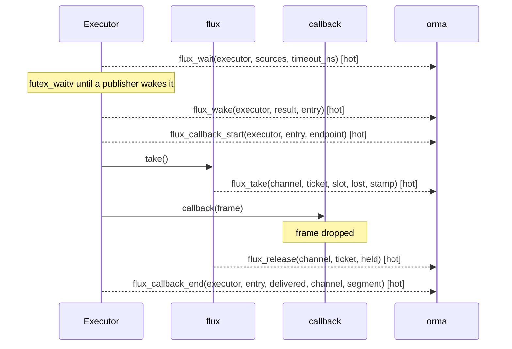
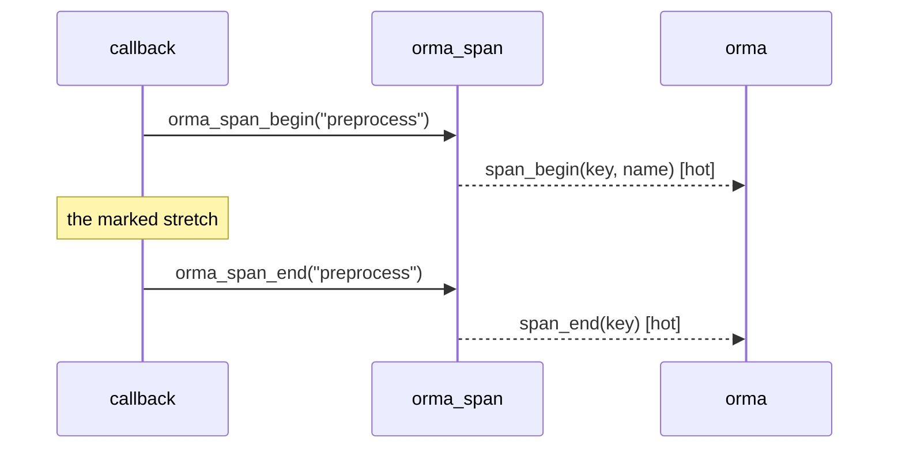

# Instrumentation

ROS 2와 flux의 주요 execution flow마다 orma가 어느 함수에 붙고 어떤 event를 받는지 적는다. sequence diagram에서 `orma` participant로 가는 화살표가 instrumentation point다. 화살표 이름은 orma event 이름이고, 괄호 안은 orma가 쓰는 인자, 대괄호 안은 uprobe probe set이다.

목차:

- [1. General rules](#1-general-rules)
- [2. ROS execution flows](#2-ros-execution-flows)
  - [2.1 Process and node creation](#21-process-and-node-creation)
  - [2.2 Publisher and subscription creation](#22-publisher-and-subscription-creation)
  - [2.3 Timer, service and client creation](#23-timer-service-and-client-creation)
  - [2.4 Executors and callback groups](#24-executors-and-callback-groups)
  - [2.5 Wait and wakeup](#25-wait-and-wakeup)
  - [2.6 Message publishing](#26-message-publishing)
  - [2.7 Subscription callbacks](#27-subscription-callbacks)
  - [2.8 Intra-process](#28-intra-process)
  - [2.9 Timer and service callbacks](#29-timer-and-service-callbacks)
  - [2.10 rclpy](#210-rclpy)
  - [2.11 Late attach](#211-late-attach)
- [3. flux execution flows](#3-flux-execution-flows)
  - [3.1 Channel and endpoint creation](#31-channel-and-endpoint-creation)
  - [3.2 Publishing](#32-publishing)
  - [3.3 Take and callbacks](#33-take-and-callbacks)
- [4. Scheduling](#4-scheduling)
- [5. Additional collection](#5-additional-collection)
  - [5.1 Spans](#51-spans)
  - [5.2 CUDA driver calls](#52-cuda-driver-calls)
  - [5.3 DDS writes](#53-dds-writes)
  - [5.4 futex waits](#54-futex-waits)
- [6. Latency segments](#6-latency-segments)
- [7. Distro differences](#7-distro-differences)
- [8. Coverage by method](#8-coverage-by-method)
- [9. Limitations](#9-limitations)

## 1. General rules

- instrumentation point 목록은 하나. 세 method(`preload`, `lttng`, `uprobe`)가 같은 함수, 같은 field, 같은 latency segment. method별 차이는 8절
- event timestamp: `CLOCK_MONOTONIC`
- 없는 함수: 그 point만 빠지고 `probes_missing`에 기록. 빈 열이 "일이 없었다"인지 "볼 수 없었다"인지 구분용
- uprobe method는 probe set 단위로 부착

| probe set | 붙는 process |
| --- | --- |
| `discovery` | 모든 process. init, registration, fini |
| `hot` | 선택한 process. publish, take, callback, executor, `rcl_wait`, 나머지 flux 함수, `orma_span_begin`과 `orma_span_end` |
| `rclcpp_symbols` | 선택한 process. rclcpp C++ 함수 |
| `bandwidth` | 선택한 process, opt-in. DDS serialized size |
| `sched` | 선택한 process의 thread. kernel scheduler |
| `gpu` | 선택한 process, opt-in. `libcuda.so`의 driver 함수(5.2) |
| `dds` | 선택한 process, opt-in. DDS write 함수(5.3) |
| `futex` | 선택한 process의 thread, opt-in. futex syscall tracepoint(5.4) |
| `names` | 선택한 process 중 node를 모르는 callback이 있는 것. 2.11 |

일부 tracepoint는 rclcpp가 `ros_trace_enabled_<name>()`이 참일 때만 `ros_trace_do_<name>()`으로 부른다(gated tracepoint). 인자를 만드는 비용이 크기 때문이다. `rclcpp_callback_register`(callback 함수 이름)와 rmw_zenoh의 `rmw_publisher_init`이 그렇다.

| method | gated tracepoint |
| --- | --- |
| `preload` | `ros_trace_enabled_<name>`도 가로채 참을 반환, `do_` 쪽 수신 |
| `lttng` | 같은 방법으로 수신 |
| `uprobe` | 수신 불가(uprobe는 반환값을 바꾸지 못한다). callback 함수 이름은 2.7의 code address로 보완 |

gate는 이름을 주는 event에만 걸려 있고, timestamp를 재는 event에는 없다. 그래서 측정값은 method와 무관하게 같다.

## 2. ROS execution flows

아래 diagram은 Jazzy rclcpp 기준이다. distro 차이는 7절에 있다.

### 2.1 Process and node creation

`rclcpp::init()`이 `rcl_init()`을 부르고, node 생성자가 `rcl_node_init()`을 부른다. node 이름과 namespace는 여기서만 온다. orma가 이 event를 놓치면 node를 나중에 알아낸다(2.11).

수집하는 것:

- context handle(`rcl_init`)
- node handle, rmw handle, 이름, namespace(`rcl_node_init`)



### 2.2 Publisher and subscription creation

publisher와 subscription은 rclcpp, rcl, rmw 세 층에 handle이 하나씩 있다. orma는 세 handle을 이어 topic 이름을 handle에 붙인다. publish와 take event는 rmw handle만 싣기 때문이다.

수집하는 것:

- rcl handle, node handle, rmw handle, topic 이름, queue depth(`rcl_publisher_init`, `rcl_subscription_init`)
- rmw handle과 gid(`rmw_publisher_init`, `rmw_subscription_init`)
- rclcpp subscription 객체와 callback 객체(`rclcpp_subscription_init`, `rclcpp_subscription_callback_added`)
- callback 함수 이름(`rclcpp_callback_register`, gated)
- publisher 객체(`rclcpp_publisher_base`). rclcpp `PublisherBase` 생성자에 붙고, 안에서 뜨는 `rcl_publisher_init`과 thread로 짝짓는다



### 2.3 Timer, service and client creation

수집하는 것:

- timer handle과 period(`rcl_timer_init`), callback 객체(`rclcpp_timer_callback_added`), node(`rclcpp_timer_link_node`)
- timer 소멸(`rcl_timer_fini`). tracepoint가 아니라 `librcl.so`의 함수다. timer를 계속 만들고 지우는 process(예: rviz2)에서 이름 표의 칸을 회수한다
- service handle, node, rmw handle, service 이름(`rcl_service_init`), callback 객체(`rclcpp_service_callback_added`)
- client handle, node, rmw handle, service 이름(`rcl_client_init`)



### 2.4 Executors and callback groups

callback이 어느 callback group과 executor에 속하는지에는 tracepoint가 없다. orma는 rclcpp C++ 함수에 붙어 읽는다. 소속을 알아야 wait가 긴 것과 무거운 callback을 가를 수 있다.

| orma event | rclcpp 함수 | 주는 것 |
| --- | --- | --- |
| `rclcpp_group_add_subscription` | `CallbackGroup::add_subscription` | subscription -> group |
| `rclcpp_group_add_timer` | `CallbackGroup::add_timer` | timer -> group. 뒤따르는 `rclcpp_timer_link_node`와 thread로 matching |
| `rclcpp_executor` | `Executor::Executor` | executor 생성 |
| `rclcpp_collector` | `ExecutorEntitiesCollector::ExecutorEntitiesCollector` | collector -> executor |
| `rclcpp_collector_add_group_to_collection` | `ExecutorEntitiesCollector::add_callback_group_to_collection` | group -> executor |
| `rclcpp_collector_add_group` | `ExecutorEntitiesCollector::add_callback_group` | 위의 수동 API 경로 |
| `rclcpp_executor_add_group` | `Executor::add_callback_group_to_map` | group -> executor(Humble) |

규칙:

- 함수 탐색: mangled name의 앞부분(namespace, class, method). 둘 이상에 맞으면 부착하지 않고 `probes_missing`에 기록
- 함수 목록: rclcpp major 버전(16, 28 이후)별. rclcpp를 올리면 orma 재빌드(`preload`, `lttng`은 같은 이름의 함수를 정의해 가로채기 때문)
- caller에 inline된 함수는 어느 method로도 보이지 않는다. `orma check`의 `probes` 행에서 확인

### 2.5 Wait and wakeup

executor는 `rcl_wait()`에서 잠들고, ready인 handle이 생기면 깨어난다. orma는 `librcl.so`의 `rcl_wait` entry와 return을 잡는다. tracepoint가 아니라 함수 자체다. C++와 Python에 공통이고, executor 종류와 상관없이 같은 뜻이다.

수집하는 것:

- wait start(`rcl_wait_enter`)와 wakeup(`rcl_wait_exit`). 같은 thread의 둘 사이가 wait time이다
- rclcpp executor tracepoint(`rclcpp_executor_get_next_ready`, `rclcpp_executor_wait_for_work`, `rclcpp_executor_execute`). executor는 먼저 ready인 executable을 찾고(`get_next_ready`), 없을 때만 wait한다(`wait_for_work`). `rclcpp_executor_execute`가 dispatch start다



`EventsExecutor`는 `rcl_wait`를 쓰지 않으므로 wait와 wakeup이 없다. orma는 그 칸을 비워 둔다.

### 2.6 Message publishing

`publish()`는 rclcpp, rcl, rmw를 차례로 지난다. orma는 rmw 층의 event를 publish timestamp와 matching key로 쓴다. `rmw_publish`가 DDS의 source timestamp를 싣기 때문이다.

수집하는 것:

- publish 수와 rate(`rmw_publish`의 rmw handle)
- source timestamp(`rmw_publish`). take 쪽과 짝짓는 값이다(2.7)
- message 앞 8 B. message가 `header.stamp`로 시작하면 data age가 된다. orma는 message type을 모르므로, clock 검사를 통과한 값만 쓴다
- `/clock` publisher의 message 앞 8 B. sim time 기준 data age에 쓴다
- serialized size(`dds_serialized_size`, opt-in). Fast DDS의 `TypeSupport::serialize`, Cyclone DDS의 `serdata_rmw_from_sample`(dbgsym package가 있을 때만)에 붙는다. function pointer로만 불려 uprobe로만 잰다
- late attach일 때 publisher의 topic 이름(`rmw_publisher_topic`, uprobe). rmw publisher handle에서 처음 한 번 읽는다
- Jazzy rclcpp는 `rclcpp_publish`의 publisher handle 자리에 NULL을 넘긴다. publisher는 `rcl_publish`와 `rmw_publish`의 handle로 안다



`header.stamp` clock 검사:

- `sec`이 10^9 이상 4 x 10^9 미만이면 wall clock stamp로 보고 `CLOCK_REALTIME`과 비교한다.
- 아니면 sim time으로 보고 마지막 `/clock` 값과 비교한다. `/clock` publisher가 없으면 쓰지 않는다.
- stamp가 기준 시각보다 1초 넘게 앞서거나 age가 600초를 넘으면 쓰지 않는다.

### 2.7 Subscription callbacks

executor가 subscription을 고르면 rmw에서 message를 take하고 callback을 부른다. `rmw_take`는 `taken`이 참일 때만 take로 센다.

수집하는 것:

- take 수와 rate, loss(`rmw_take`)
- source timestamp(`rmw_take`). publish 쪽 `rmw_publish`와 `(topic, source timestamp)`로 짝지어 transport latency를 낸다
- message 앞 8 B(`rmw_take`). 2.6과 같은 규칙이다
- callback start와 end(`callback_start`, `callback_end`). `callback_start`는 intra-process 여부를 싣는다
- callback의 code address(`callback_code`). callback이 처음 돌 때 callback 객체 안 `std::function`의 code address를 읽는다. orma-collectd가 `/proc/<pid>/maps`와 ELF symbol로 함수 이름을 푼다. gate 때문에 `rclcpp_callback_register`가 오지 않는 uprobe method와, 이름 문자열이 비는 Humble에서 쓴다
- late attach일 때 subscription의 topic 이름(`rmw_subscription_topic`, uprobe). `rmw_take`의 rmw subscription handle에서 처음 한 번 읽는다



같은 topic에서 publisher 둘이 같은 source timestamp를 내면 잇지 않고 ambiguous로 센다. matching key에 topic을 넣는 이유는 다른 topic의 message가 같은 nanosecond 값을 가질 수 있기 때문이다.

### 2.8 Intra-process

intra-process 전달에는 rmw take가 없다. 그래서 transport latency와 take rate를 잴 수 없다. orma는 `callback_start`의 `is_intra_process`로 전달 경로를 가리고, publish rate는 `rclcpp_intra_publish`로 보인다.

연결 관계는 rclcpp C++ 함수에서 읽는다.

| orma event | rclcpp 함수 | 주는 것 |
| --- | --- | --- |
| `rclcpp_publisher_setup_intra` | `PublisherBase::setup_intra_process` | intra publisher id -> rcl handle |
| `rclcpp_subscription_setup_intra` | `SubscriptionBase::setup_intra_process` | intra subscription id -> rclcpp subscription |
| `rclcpp_ipm_insert_sub_id_for_pub` | `IntraProcessManager::insert_sub_id_for_pub` | process 안 publisher -> subscription |

intra-process buffer tracepoint(`rclcpp_ring_buffer_*`, `rclcpp_buffer_to_ipb`, `rclcpp_ipb_to_subscription`)는 수집하지 않는다.

### 2.9 Timer and service callbacks

timer와 service callback도 `callback_start`와 `callback_end` 사이로 잰다. callback 객체는 2.3의 `*_callback_added`가 timer나 service에 이어 둔 것이다.

- timer: expected rate는 `rcl_timer_init`의 period에서 온다. `orma node cb`의 `expected` 열이다.
- service: request와 response latency는 재지 않는다. rmw client, service tracepoint(`rmw_client_init`, `rmw_send_request`, `rmw_take_request`, `rmw_send_response`, `rmw_take_response`)는 Kilted부터 있고 Humble, Jazzy에는 없다. service callback duration만 낸다.

### 2.10 rclpy

rclpy는 `ros_trace_*`를 직접 부르지 않는다. rcl과 rmw를 거치는 event(init, `rcl_publish`, `rmw_publish`, `rmw_take`, `rcl_wait`)는 Python node에서도 나오지만, registration과 callback event는 나오지 않는다. `orma_rclpy`가 그 빈칸을 채운다. 부르는 함수는 C++ node와 같은 `libtracetools.so`의 `ros_trace_*`이므로, 세 method가 C++ node와 똑같이 받는다.

| event | rclpy에서 나오나 | `orma_rclpy`가 하는 일 |
| --- | --- | --- |
| `rcl_*_init`, `rcl_publish`, `rmw_publish`, `rmw_take`, `rcl_wait` | 나온다 | - |
| `rclcpp_subscription_init`, `rclcpp_subscription_callback_added` | 안 나온다 | subscription 생성 시 호출. rclcpp subscription 객체 자리에 Python `Subscription` 객체 주소 |
| `rclcpp_service_callback_added` | 안 나온다 | service 생성 시 호출 |
| `rclcpp_timer_callback_added`, `rclcpp_timer_link_node` | 안 나온다 | timer 생성 시 호출 |
| `rclcpp_callback_register` | 안 나온다 | callback의 `__qualname__`으로 호출. gate 없는 이름이라 uprobe method도 수신 |
| `rclcpp_executor_*` | 안 나온다 | 호출하지 않는다. wakeup은 `rcl_wait` return으로 측정 |
| `callback_start`, `callback_end` | 안 나온다 | entity의 `callback` 속성을 감싼 함수가 callback 앞뒤에서 호출 |

- 감싸는 함수: `rclpy.node.Node`의 `create_subscription`, `create_service`, `create_timer`
- module은 process 시작 시 로드(`orma run`, `OrmaTrace`가 `PYTHONPATH`에 추가). 실행 중인 Python node는 재시작 필요. uprobe method도 마찬가지
- user site가 꺼진 process(가상환경, `python3 -s`, `-I`)에서는 로드되지 않는다
- 사용자가 `callback` 속성을 다시 바꾼 entity는 `callback_*` 미발생(예: `create_rate`의 timer)
- coroutine callback: `await`로 멈춘 시간도 callback duration에 포함

### 2.11 Late attach

orma가 entity보다 늦게 붙으면 2.1-2.3의 event가 없어 callback의 node를 모른다. rcl과 rmw handle에는 node를 가리키는 값이 없고, node는 rclcpp 객체에만 있다. 그래서 uprobe method는 executor가 callback을 돌리는 함수에서 node를 읽는다.

```text
Executor::execute_any_executable(AnyExecutable &)   uprobe, probe set names
  AnyExecutable.subscription -> SubscriptionBase -> node_handle_ -> rcl_node_t -> impl -> fq_name
  AnyExecutable.service      -> ServiceBase      -> node_handle_ -> ...
  AnyExecutable.timer        -> (no node) callback_group -> first subscription, service or client's node_handle_
callback_start(callback)      same thread, one level deep -> rclcpp_callback_owner (once per callback)
```

- `rclcpp_callback_owner` event는 callback, 그 entity, rcl handle, node handle, 종류, node FQN을 싣는다. orma-collectd는 이것을 놓친 init event 대신 쓴다.
- 이 uprobe는 callback마다 불린다(Orin에서 약 1.25 us). 그래서 probe set `names`는 node를 모르는 callback이 처음 돈 지 10초 안인 process에만 붙인다. node를 알면 뗀다. 10초 안에 못 찾으면 포기하고 뗀다.
- subscription의 topic은 `rmw_subscription_topic`(2.7)에서 온다. service 이름은 읽지 않는다. late attach한 service callback은 `srv`와 함수 이름만 보인다.
- timer는 node를 갖지 않는다. 그 callback group의 첫 subscription, service, client의 node를 쓴다. timer만 든 group의 timer는 node를 모른 채 남는다.
- 보이지 않는 것: `execute_any_executable`을 거치지 않는 executor(Humble의 `StaticSingleThreadedExecutor`, `EventsExecutor`), intra-process로만 받는 subscription, rclpy. 이들은 `orma node` 명령의 node 열에 `unlinked`로 남는다.

## 3. flux execution flows

flux는 `libflux_ffi.so`가 export하는 `flux_trace_*` 함수를 부른다. 몸체는 비어 있고 enabled 검사가 없어, 세 method가 모두 함수 자체에 붙는다. 함수 이름과 인자가 계약이고, 버전은 아무것도 하지 않는 symbol `flux_trace_contract_2`다. orma는 이 symbol을 export하는 library에만 붙는다. 다른 버전의 library는 인자가 다르므로 잘못 읽는 대신 거절한다.

- channel id는 flux channel 공유 상태의 주소이고, re-attach 전까지 고정이다. executor id는 executor control block의 주소다.
- 문자열 인자: 255 B까지
- flux를 정적으로 링크한 프로그램은 함수를 직접 불러 `preload`, `lttng`에 보이지 않는다.

### 3.1 Channel and endpoint creation

수집하는 것:

- channel handle, segment(device, inode, 이름), publisher 여부, slot 수와 크기, payload 안 `header.stamp` 위치(`flux_channel_init`). 생성과 re-attach 때 나온다
- endpoint handle, node, key, signpost, fingerprint, role(publisher, subscription), language(C++, Python)(`flux_endpoint_init`). flux_cpp와 flux_py의 `Publisher`, `Subscription` 생성자에서 나온다



orma가 channel보다 늦게 붙으면 `flux_callback_end`가 싣는 segment 이름으로 channel을 안다. callback 이름은 그 channel의 signpost가 가진 key다.

### 3.2 Publishing

publish에는 두 경로가 있다. copy 경로는 slot을 claim하고 바로 commit한다. loan 경로는 slot을 사용자에게 loan하고, 사용자가 쓴 뒤 commit한다.

수집하는 것:

- slot claim 결과와 실패 이유(`flux_claim`). 실패하면 slot은 `UINT32_MAX`다
- loan start와 end, 결과(`flux_loan`, `flux_loan_end`). commit에 성공하면 `loan_end`는 `commit` 다음에 나온다. 쓰지 않고 버린 loan은 abort로 끝난다
- publish(`flux_commit`). ticket, slot, byte 수, 깨운 subscription 수, `header.stamp`를 싣는다



flux_bag recorder가 frame을 bag에 쓰지 못하고 버리면 `flux_record_drop`이 나온다. orma는 recording loss로 보인다.

sticky CUDA error가 process의 GPU를 멈추면 `flux_gpu_wedged(result)`가 process마다 한 번 나온다. `result`는 그 `CUresult`다. 그 뒤로 GPU channel의 claim, loan, take는 `CLAIM_GPU_WEDGED`, `LOAN_GPU_WEDGED`, `REFUSED_GPU_WEDGED`로 실패하고 orma는 topic의 publish drop으로 센다. `orma node cpu`는 그 process에 경고 한 줄을 붙인다. ormad는 이 함수를 discovery set으로 모든 flux process에 붙인다. 이 함수가 없는 이전 flux build에서는 `probes_missing`에 남는다.

### 3.3 Take and callbacks

flux executor는 wait word에서 잠들고, publisher가 깨우면 callback을 돌린다. `flux_wake`는 무엇이 깨웠는지(source, control word, timeout, already ready)와 깨운 entry 번호를 싣는다. signal(`WAKE_SIGNAL`)은 이전 flux build만 낸다. 지금 flux는 `EINTR`이면 남은 deadline으로 다시 기다린다.

수집하는 것:

- wait start(`flux_wait`). wait word 수와 timeout
- wakeup과 깨운 것(`flux_wake`)
- callback start와 end(`flux_callback_start`, `flux_callback_end`). start는 endpoint를, end는 delivered 여부, channel, segment를 싣는다
- take(`flux_take`). ticket, slot, 놓친 frame 수, `header.stamp`를 싣는다. publish 쪽 `flux_commit`과 `(segment, ticket)`으로 짝짓는다
- borrow refused와 이유(`flux_refused`)
- lease end(`flux_release`). `held`가 1이면 fence 실패로 borrow를 쥔 채 남는다
- Python: GIL wait(`flux_py_gil`, phase 0과 1 사이)와 frame을 Python 객체로 만든 시점(`flux_py_ready`). `py_ready`는 같은 `(channel, ticket)`의 `take`와 짝짓는다



## 4. Scheduling

thread의 wakeup, CPU를 받은 시각(switch-in), CPU를 놓은 시각(switch-out)이다. kernel tracepoint `sched_switch`와 `sched_wakeup`을 eBPF로 받으므로 ormad가 있어야 한다. collection method와는 무관하다. 대상 thread만 kernel 안에서 거른다.

두 가지에 쓴다.

- scheduling latency: switch-in 시각 - wakeup 시각
- callback 안 off-CPU time: callback start와 end 사이에 thread가 CPU를 놓은 시간. ormad는 그 thread가 지금 어느 callback 안에 있는지 알아야 한다. uprobe method는 eBPF가 callback stack을 쥐고, `preload`와 `lttng`은 thread마다 지금 callback을 shared memory 파일에 두고 ormad가 읽는다

node별 CPU는 callback 안 on-CPU time(callback duration - callback 안 off-CPU time)으로 node에 나눈다. DDS와 SDK thread처럼 callback 밖에서 도는 몫은 process 공용 몫으로 따로 보인다. `sched`가 없으면 callback wall time으로 낸 상한을 쓰고, `orma node cpu`의 CPU source 열이 `wall_bound`가 된다.

## 5. Additional collection

span은 항상 수집한다. 나머지는 client가 켤 때만 붙는다(`--gpu`, `--dds`, `--futex`, rqt의 Selection tab). event마다 thread와 시각이 있어 orma-collectd가 그 thread의 지금 callback에 붙인다.

### 5.1 Spans

사용자가 코드에 표시한 구간이다. `liborma_span.so`의 `orma_span_begin(name)`, `orma_span_end(name)`은 몸체가 빈 함수다. C++ `orma::Span`과 Python decorator `orma_span.span`도 이 둘을 부른다.

수집하는 것:

- span start(`span_begin`). 이름 문자열의 주소(key)와 이름. 이름은 begin에서만 읽는다
- span end(`span_end`). key



- begin과 end는 같은 thread에서 key로 짝짓는다. 짝 없는 end는 버린다
- span 안의 span은 감싼 span을, callback 안의 span은 감싼 callback을 갖는다
- 이름은 정적 수명의 문자열이어야 한다. 주소가 다르면 begin과 end가 이어지지 않는다

### 5.2 CUDA driver calls

`libcuda.so`의 driver 함수 entry와 return이다. 호출 하나가 record 하나다.

| 종류 | 함수 |
| --- | --- |
| launch | kernel launch, graph launch |
| copy | 동기 copy, 비동기 copy(`_v2` 이름과 `_ptds`/`_ptsz` 변형). byte 수는 인자에서. 2D, 3D copy는 width x height(x depth) |
| synchronize | stream, context, event synchronize |
| memory | 할당, 해제 |

수집하는 것(`cuda_call`): 호출 시간, byte 수, 종류, `CUresult`

- 재는 것은 host 쪽 호출 시간이다. GPU 안의 kernel 실행 시간은 재지 않는다. 비동기 launch는 바로 반환하고, 기다린 시간은 synchronize와 동기 copy에 나타난다
- cudart는 libcuda를 자기 handle의 `dlsym`과 `cuGetProcAddress`로 얻는다. `preload`와 `lttng`은 이 둘도 가로채 자기 CUDA 함수를 건넨다. 그래서 cudart를 정적으로 링크한 프로그램(nvcc 기본)도 잡힌다. `uprobe`는 함수 주소에 붙으므로 경로와 무관하다
- ormad는 Jetson의 `nvidia/`, `tegra/` 아래 `libcuda.so`에도 붙는다
- orma는 CUDA toolkit 없이 빌드한다. 시간을 재는 함수의 prototype은 `orma_preload`의 `cuda_api.h`에 있다

### 5.3 DDS writes

DDS write 함수의 entry와 return이다. 호출 하나가 record 하나다.

| DDS | 함수 |
| --- | --- |
| Cyclone DDS(`libddsc.so`) | `dds_write`, `dds_write_ts`, `dds_writecdr`, `dds_forwardcdr` |
| Fast DDS(`libfastrtps.so` 2.x, `libfastdds.so` 3.x) | `DataWriter::write` overload |

수집하는 것(`dds_write`): writer, 호출 시간

- orma-collectd는 write를 같은 thread의 진행 중인 `rcl_publish`와 짝지어 topic을 붙인다. 짝이 없는 write는 버린다
- segment 두 개를 낸다(6절): publish에서 DDS write 시작까지, DDS write 호출 시간

### 5.4 futex waits

kernel tracepoint `syscalls:sys_enter_futex`/`sys_exit_futex`와 `futex_waitv` 쌍을 eBPF로 받는다. ormad가 있어야 하고 collection method와는 무관하다. 대상 thread만 kernel 안에서 거른다.

- 대상: 대기 command(`FUTEX_WAIT`, `FUTEX_WAIT_BITSET`, `FUTEX_LOCK_PI`, `FUTEX_LOCK_PI2`, `FUTEX_WAIT_REQUEUE_PI`)와 `futex_waitv`
- 수집하는 것(`futex_wait`, return 때): 주소, 대기 시간, command, 반환값
- callback 안 대기: callback start 전에 시작한 대기는 callback start부터 센다

## 6. Latency segments

ROS topic과 flux channel을 같은 segment로 잰다.

| event | ROS | flux |
| --- | --- | --- |
| publish | `rmw_publish` | `flux_commit` |
| matching key | `(topic, source timestamp)` | `(segment, ticket)` |
| take | `rmw_take`(`taken`이 참) | `flux_take` |
| wait start | `rcl_wait` entry | `flux_wait` |
| wakeup | `rcl_wait` return | `flux_wake` |
| dispatch start | `rclcpp_executor_execute` | - |
| callback | `callback_start` -> `callback_end` | `flux_callback_start` -> `flux_callback_end` |

| segment | 정의 |
| --- | --- |
| transport latency | take - publish(같은 message) |
| wait time | wakeup - wait start(같은 thread) |
| wakeup latency | wakeup - publish |
| dispatch latency | callback start - wakeup |
| callback duration | callback end - callback start |
| callback on-CPU time | callback duration - callback 안 off-CPU time |
| scheduling latency | switch-in - wakeup(4절) |
| pub to dds | DDS write start - `rclcpp_publish`(없으면 `rcl_publish`), 같은 thread(5.3) |
| dds write | DDS write 호출 시간(5.3) |
| span duration | `span_end` - `span_begin`(5.1) |

- process 안 segment(callback duration, dispatch latency): instrumentation point에서 aggregate. `lttng`만 orma-collectd에서
- process 사이 segment(transport latency, wakeup latency): orma-collectd가 matching
- `orma analyze`: recording을 이 segment로 분할

## 7. Distro differences

orma는 process마다 distro를 판정한다. 한 host에 Jazzy process와 Humble container가 함께 있을 수 있기 때문이다. 판정은 `/proc/<pid>/environ`의 `ROS_DISTRO`, 없으면 매핑된 `libtracetools.so`의 경로(`/opt/ros/<distro>/`)로 한다. 파일은 모두 `/proc/<pid>/root`를 거쳐 열므로 container 안의 library도 그 container의 파일로 판정한다.

| 항목 | Humble | Jazzy |
| --- | --- | --- |
| `libtracetools.so`의 LTTng | X. `lttng` method는 `liborma_lttng.so`의 `ros2` provider가 대신 생성 | O |
| `rclcpp_callback_register` | gate 미적용. 이름 문자열이 빌 수 있어 `callback_code`로 보완 | gated(1절) |
| publish ABI | rcl: `ros_trace_rmw_publish(message)`(orma event `rmw_publish_rcl`). publisher key는 `rcl_publish`의 rcl handle | rmw: `ros_trace_rmw_publish(rmw_handle, message, timestamp)` |
| transport latency | take 시각 - source timestamp(wall clock). publish 쪽 timestamp 부재로 matching 불가, 같은 host에서만 유효 | matching한 monotonic 시각 차 |
| `rclcpp_intra_publish` | X. intra-process 전용 topic은 행 미생성 | O |
| executor 소속 | `Executor::add_callback_group_to_map`(`rclcpp_executor_add_group`) | `ExecutorEntitiesCollector` 함수 |
| rmw client, service tracepoint | X(orma 미부착) | X(orma 미부착) |

## 8. Coverage by method

| 항목 | `uprobe` | `preload` | `lttng` |
| --- | --- | --- | --- |
| 붙이는 때 | 돌고 있는 process | process 시작 | process 시작 |
| ROS tracepoint | gated tracepoint를 뺀 전부 | 전부 | 전부 |
| callback 함수 이름 | `callback_code` | `rclcpp_callback_register` | `rclcpp_callback_register` |
| `rcl_wait`, `rcl_timer_fini`, rclcpp C++ 함수 | O | O | O |
| late attach일 때 topic과 node(2.11) | O | -(시작부터 부착) | - |
| DDS serialized size | opt-in | 이 uprobe 추가 필요 | 이 uprobe 추가 필요 |
| `header.stamp`, `/clock` | O | O | O |
| flux event | O | O | O |
| span | O | O | O |
| CUDA driver 호출(opt-in) | O | O | O |
| DDS write(opt-in) | O | O | O |
| futex 대기(opt-in) | ormad | ormad | ormad |
| callback 안 CPU, scheduling latency | ormad | ormad가 있을 때 | ormad가 있을 때 |
| malloc attribution(opt-in) | X | O | X |
| 권한 | ormad | 불필요 | 사용자 session daemon |

`liborma_preload.so`와 `liborma_lttng.so`는 함께 넣을 수 있다. 둘 다 원래 함수를 `dlsym(RTLD_NEXT)`로 부르므로, 앞의 것이 받고 넘기면 뒤의 것이 받고, 마지막에 원래 함수(uprobe가 붙는 곳)가 불린다.

## 9. Limitations

ROS 2는 고치지 않는다. 한계마다 우회나 받아들인 빈칸이 있다.

| 한계 | 결과 | 대응 |
| --- | --- | --- |
| gated tracepoint(1절) | uprobe는 callback 함수 이름과 zenoh publisher gid를 받지 못한다 | 함수 이름은 `callback_code`로 채운다. 측정값은 같다 |
| rclpy는 callback event를 내지 않는다 | Python callback duration과 소속이 없다 | `orma_rclpy`(2.10). 이미 돌고 있는 Python node는 재시작해야 한다 |
| Humble, Jazzy에는 rmw client, service tracepoint가 없다 | service request와 response latency를 잴 수 없다 | service callback duration만 낸다 |
| publish와 take를 잇는 값은 source timestamp뿐이다 | source timestamp만으로 짝지으면 다른 topic의 message가 섞인다 | matching key에 topic을 넣는다. 같은 topic에서 겹치면 ambiguous로 센다 |
| intra-process 전달에는 take가 없다 | transport latency와 take rate가 없다 | `is_intra_process`로 경로를 가리고 publish rate를 보인다(2.8) |
| executor와 callback group 소속에는 tracepoint가 없다 | 소속 없이는 wait와 무거운 callback을 가르지 못한다 | rclcpp C++ 함수에서 읽는다(2.4). inline된 함수는 보이지 않는다 |
| DDS thread와 heap은 process의 node 전부가 같이 쓴다 | node에 나눌 근거가 없다 | process 공용 몫으로 따로 보인다 |
| memory는 address space 단위다 | node별 memory가 없다 | process RSS, PSS만 낸다. callback별 malloc attribution은 `preload`의 opt-in |
| serialized size는 rmw 내부 함수에만 있다 | `preload`, `lttng`로는 bandwidth를 볼 수 없다 | uprobe opt-in으로만 잰다 |
| late attach하면 init과 registration event를 놓친다 | 이름과 소속이 빈다 | topic은 rmw handle에서, node는 executor에서 읽는다(2.11). 못 찾은 것은 `unlinked`로 둔다 |
| orma는 message type을 모른다 | `header.stamp` 위치를 모른다 | 앞 8 B를 읽고 clock 검사를 통과한 값만 쓴다(2.6) |
| `EventsExecutor`는 `rcl_wait`를 쓰지 않는다 | wait와 wakeup이 없다 | 그 칸을 비워 둔다 |
| CUDA는 host 쪽 호출만 보인다 | GPU 안의 kernel 실행 시간이 없다 | synchronize와 동기 copy의 대기 시간으로 본다(5.2) |
