# 수집 지점

ROS 2와 flux의 주요 실행 흐름마다 orma가 어느 함수에 부착하고 어떤 이벤트를 받는지 적는다. sequence diagram에서 `orma` participant로 가는 화살표가 수집 지점이다. 화살표 이름은 orma 이벤트 이름이고, 괄호 안은 orma가 사용하는 인자, 대괄호 안은 uprobe probe set이다.

목차:

- [1. 일반 규칙](#1-일반-규칙)
- [2. ROS 실행 흐름](#2-ros-실행-흐름)
  - [2.1 프로세스와 노드 생성](#21-프로세스와-노드-생성)
  - [2.2 발행자와 구독 생성](#22-발행자와-구독-생성)
  - [2.3 타이머, 서비스, 클라이언트 생성](#23-타이머-서비스-클라이언트-생성)
  - [2.4 executor와 콜백 그룹](#24-executor와-콜백-그룹)
  - [2.5 대기와 깨어남](#25-대기와-깨어남)
  - [2.6 메시지 발행](#26-메시지-발행)
  - [2.7 구독 콜백](#27-구독-콜백)
  - [2.8 intra-process](#28-intra-process)
  - [2.9 타이머와 서비스 콜백](#29-타이머와-서비스-콜백)
  - [2.10 rclpy](#210-rclpy)
  - [2.11 late attach](#211-late-attach)
  - [2.12 rcl_executor](#212-rcl_executor)
  - [2.13 전달 경로](#213-전달-경로)
- [3. flux 실행 흐름](#3-flux-실행-흐름)
  - [3.1 채널과 엔드포인트 생성](#31-채널과-엔드포인트-생성)
  - [3.2 발행](#32-발행)
  - [3.3 take와 콜백](#33-take와-콜백)
- [4. 스케줄링](#4-스케줄링)
- [5. 추가 수집](#5-추가-수집)
  - [5.1 span](#51-span)
  - [5.2 CUDA driver 호출](#52-cuda-driver-호출)
  - [5.3 DDS write](#53-dds-write)
  - [5.4 futex 대기](#54-futex-대기)
- [6. 지연 구간](#6-지연-구간)
- [7. distro 차이](#7-distro-차이)
- [8. 수집 방식별 범위](#8-수집-방식별-범위)
- [9. 한계](#9-한계)

## 1. 일반 규칙

- 수집 지점 목록은 하나다. 세 수집 방식(`preload`, `lttng`, `uprobe`)은 같은 함수에 부착하고, 같은 필드와 같은 지연 구간을 산출한다. 수집 방식별 차이는 8절에 있다.
- 이벤트 시각은 `CLOCK_MONOTONIC`이다.
- 함수가 없으면 그 지점만 제외되고 `probes_missing`에 기록된다. 빈 열이 "일이 없었다"인지 "볼 수 없었다"인지 구별하기 위해서다.
- `uprobe` 방식은 probe set 단위로 부착한다.

| probe set | 부착하는 프로세스와 함수 |
| --- | --- |
| `discovery` | 모든 프로세스. init, 등록, fini |
| `hot` | 선택한 프로세스. 발행, take, 콜백, executor, `rcl_wait`, 나머지 flux 함수, `orma_span_begin`과 `orma_span_end`, rcl_executor anchor(2.12), 전달 경로 probe(2.13) |
| `rclcpp_symbols` | 선택한 프로세스. rclcpp C++ 함수 |
| `bandwidth` | 선택한 프로세스, opt-in. DDS serialized size |
| `sched` | 선택한 프로세스의 스레드. 커널 스케줄러 |
| `gpu` | 선택한 프로세스, opt-in. `libcuda.so`의 driver 함수(5.2) |
| `dds` | 선택한 프로세스, opt-in. DDS write 함수(5.3) |
| `futex` | 선택한 프로세스의 스레드, opt-in. futex syscall tracepoint(5.4) |
| `names` | 선택한 프로세스 중 노드를 모르는 콜백이 있는 것(2.11) |

일부 tracepoint는 `ros_trace_enabled_<name>()`이 참인 경우에만 rclcpp가 `ros_trace_do_<name>()`으로 호출한다(gated tracepoint). 인자를 만드는 비용이 크기 때문이다. `rclcpp_callback_register`(콜백 함수 이름)와 rmw_zenoh의 `rmw_publisher_init`이 해당한다.

| 수집 방식 | gated tracepoint |
| --- | --- |
| `preload` | `ros_trace_enabled_<name>`도 가로채 참을 반환하고, `do_` 쪽을 받는다 |
| `lttng` | `preload`와 같은 방법으로 받는다 |
| `uprobe` | 수신 불가능하다. uprobe는 반환값 변경이 불가능하므로 콜백 함수 이름은 2.7의 code address로 채운다 |

gate는 이름을 주는 이벤트에만 있고 시각을 재는 이벤트에는 없으므로, 측정값은 수집 방식과 관계없이 같다.

## 2. ROS 실행 흐름

아래 diagram은 Jazzy rclcpp 기준이다. distro 차이는 7절에 있다.

### 2.1 프로세스와 노드 생성

`rclcpp::init()`이 `rcl_init()`을, 노드 생성자가 `rcl_node_init()`을 호출한다. 노드 이름과 namespace는 여기서만 온다. orma가 이 이벤트를 놓치면 노드를 나중에 알아낸다(2.11).

수집하는 것:

- context 핸들(`rcl_init`)
- 노드 핸들, rmw 핸들, 이름, namespace(`rcl_node_init`)

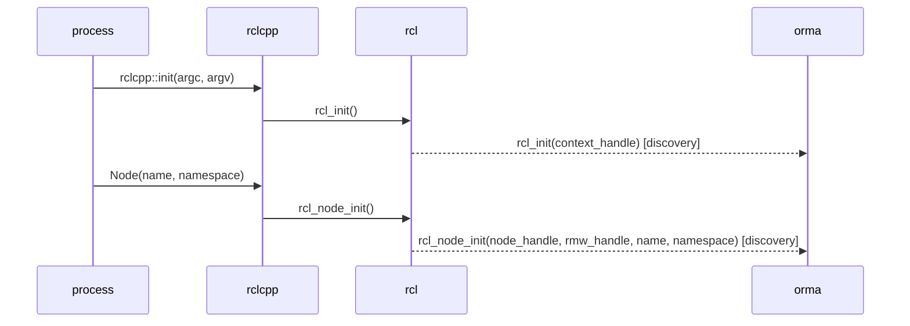

### 2.2 발행자와 구독 생성

발행자와 구독은 rclcpp, rcl, rmw 세 층에 핸들이 하나씩 있다. 발행과 take 이벤트는 rmw 핸들만 싣기 때문에, orma는 세 핸들을 이어 토픽 이름을 핸들에 연결한다.

수집하는 것:

- rcl 핸들, 노드 핸들, rmw 핸들, 토픽 이름, queue depth(`rcl_publisher_init`, `rcl_subscription_init`)
- rmw 핸들과 gid(`rmw_publisher_init`, `rmw_subscription_init`)
- rclcpp 구독 객체와 콜백 객체(`rclcpp_subscription_init`, `rclcpp_subscription_callback_added`)
- 콜백 함수 이름(`rclcpp_callback_register`, gated)
- 발행자 객체(`rclcpp_publisher_base`). rclcpp `PublisherBase` 생성자에 부착하고, 그 안에서 발생하는 `rcl_publisher_init`과 스레드로 짝짓는다

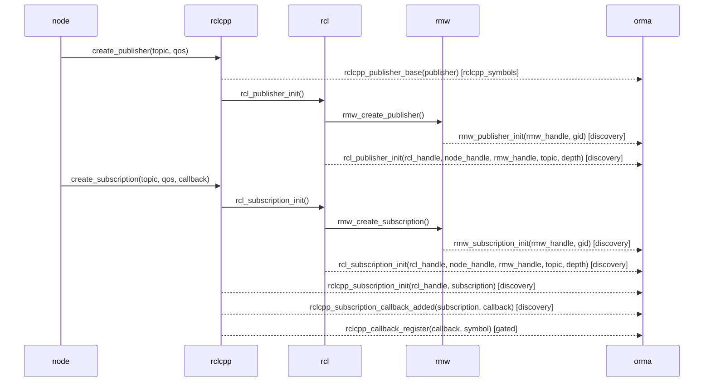

### 2.3 타이머, 서비스, 클라이언트 생성

수집하는 것:

- 타이머 핸들과 period(`rcl_timer_init`), 콜백 객체(`rclcpp_timer_callback_added`), 노드(`rclcpp_timer_link_node`)
- 타이머 소멸(`rcl_timer_fini`). tracepoint가 아니라 `librcl.so`의 함수다. 타이머를 반복해 만들고 지우는 프로세스(예: rviz2)에서 이름 표의 칸을 회수한다
- 서비스 핸들, 노드, rmw 핸들, 서비스 이름(`rcl_service_init`), 콜백 객체(`rclcpp_service_callback_added`)
- 클라이언트 핸들, 노드, rmw 핸들, 서비스 이름(`rcl_client_init`)

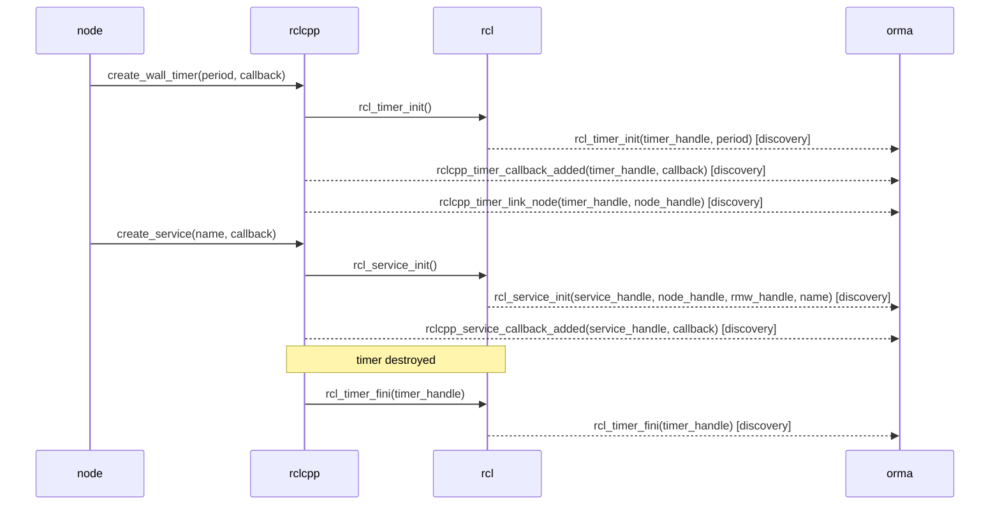

### 2.4 executor와 콜백 그룹

콜백이 어느 콜백 그룹과 executor에 속하는지를 알려 주는 tracepoint는 없다. orma는 rclcpp C++ 함수에 부착해 읽는다. 소속을 알아야 대기가 긴 경우와 무거운 콜백을 구별 가능하다.

| orma 이벤트 | rclcpp 함수 | 주는 것 |
| --- | --- | --- |
| `rclcpp_group_add_subscription` | `CallbackGroup::add_subscription` | 구독 -> 그룹 |
| `rclcpp_group_add_timer` | `CallbackGroup::add_timer` | 타이머 -> 그룹. 뒤따르는 `rclcpp_timer_link_node`와 스레드로 짝짓는다 |
| `rclcpp_executor` | `Executor::Executor` | executor 생성 |
| `rclcpp_collector` | `ExecutorEntitiesCollector::ExecutorEntitiesCollector` | collector -> executor |
| `rclcpp_collector_add_group_to_collection` | `ExecutorEntitiesCollector::add_callback_group_to_collection` | 그룹 -> executor |
| `rclcpp_collector_add_group` | `ExecutorEntitiesCollector::add_callback_group` | 그룹 -> executor(수동 API 경로) |
| `rclcpp_executor_add_group` | `Executor::add_callback_group_to_map` | 그룹 -> executor(Humble) |

- 함수는 mangled name의 앞부분(namespace, class, method)으로 찾는다. 둘 이상이 맞으면 부착하지 않고 `probes_missing`에 기록한다.
- 함수 목록은 rclcpp major 버전(16, 28 이후)마다 따로 있다. `preload`, `lttng`은 같은 이름의 함수를 정의해 가로채므로, rclcpp를 올리면 orma를 다시 빌드한다.
- 호출한 쪽에 inline된 함수는 어느 수집 방식으로도 보이지 않는다. `orma check`의 `probes` 행에서 확인한다.

### 2.5 대기와 깨어남

executor는 `rcl_wait()`에서 잠들고, ready인 핸들이 생기면 깨어난다. orma는 `librcl.so`의 `rcl_wait` 함수 자체의 entry와 return을 수집한다. C++와 Python에 공통이고, executor 종류와 관계없이 뜻이 같다.

수집하는 것:

- 대기 시작(`rcl_wait_enter`)과 깨어남(`rcl_wait_exit`). 같은 스레드에서 둘 사이가 wait time이다
- rclcpp executor tracepoint(`rclcpp_executor_get_next_ready`, `rclcpp_executor_wait_for_work`, `rclcpp_executor_execute`). executor는 ready인 executable을 먼저 찾고(`get_next_ready`), 없는 경우에만 대기한다(`wait_for_work`). `rclcpp_executor_execute`가 dispatch 시작이다

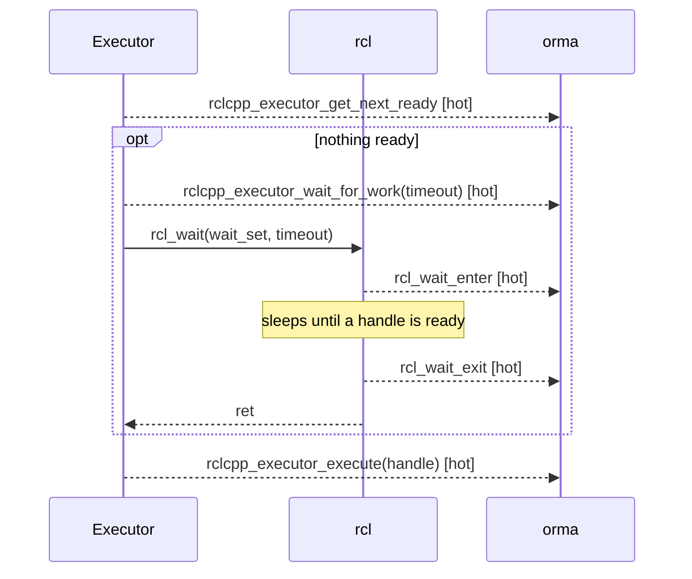

`EventsExecutor`는 `rcl_wait`를 사용하지 않으므로 대기와 깨어남이 없고, orma는 그 칸을 비운다. `RclExecutor`도 `rcl_wait`를 사용하지 않는다. 그 대기와 dispatch는 2.12의 anchor에서 받는다.

### 2.6 메시지 발행

`publish()`는 rclcpp, rcl, rmw를 차례로 지난다. `rmw_publish`가 DDS의 source timestamp를 싣기 때문에, orma는 rmw 층의 이벤트를 발행 시각과 matching key로 사용한다.

수집하는 것:

- 발행 수와 빈도(`rmw_publish`의 rmw 핸들)
- source timestamp(`rmw_publish`). take 쪽과 짝짓는 값이다(2.7)
- 메시지 앞 8 B. 메시지가 `header.stamp`로 시작하면 data age가 된다. orma는 메시지 타입을 모르므로 clock 검사를 통과한 값만 사용한다
- `/clock` 발행자의 메시지 앞 8 B. sim time으로 data age를 잴 때 사용한다
- serialized size(`dds_serialized_size`, opt-in). Fast DDS의 `TypeSupport::serialize`, Cyclone DDS의 `serdata_rmw_from_sample`(dbgsym 패키지가 있는 경우만)에 부착한다. 이 함수들은 function pointer로만 호출되므로 uprobe로만 잰다
- late attach인 경우 발행자의 토픽 이름(`rmw_publisher_topic`, uprobe). rmw 발행자 핸들에서 처음 한 번 읽는다
- Jazzy rclcpp는 `rclcpp_publish`의 발행자 핸들 자리에 NULL을 넘긴다. 발행자는 `rcl_publish`와 `rmw_publish`의 핸들로 구별한다

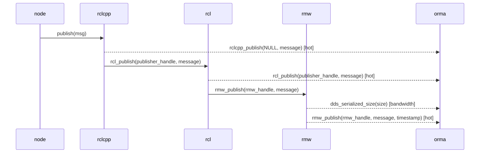

`header.stamp` clock 검사:

- `sec`이 10^9 이상 4 x 10^9 미만이면 wall clock stamp로 보고 `CLOCK_REALTIME`과 비교한다.
- 그 밖에는 sim time으로 보고 마지막 `/clock` 값과 비교한다. `/clock` 발행자가 없으면 사용하지 않는다.
- stamp가 기준 시각보다 1 s 넘게 앞서거나 age가 600 s를 넘으면 사용하지 않는다.

### 2.7 구독 콜백

executor가 구독을 고르면 rmw에서 메시지를 take하고 콜백을 호출한다. `rmw_take`는 `taken`이 참인 경우에만 take로 센다.

수집하는 것:

- take 수와 빈도, 손실(`rmw_take`)
- source timestamp(`rmw_take`). 발행 쪽 `rmw_publish`와 `(topic, source timestamp)`로 짝지어 transport latency를 산출한다
- 메시지 앞 8 B(`rmw_take`). 규칙은 2.6과 같다
- 콜백 시작과 끝(`callback_start`, `callback_end`). `callback_start`는 intra-process 여부를 싣는다
- 콜백의 code address(`callback_code`). 콜백이 처음 실행될 때 콜백 객체 안 `std::function`의 code address를 읽고, orma-collectd가 `/proc/<pid>/maps`와 ELF 심볼로 함수 이름을 해석한다. gate 때문에 `rclcpp_callback_register`가 오지 않는 uprobe method와, 이름 문자열이 비는 Humble에서 사용한다
- late attach인 경우 구독의 토픽 이름(`rmw_subscription_topic`, uprobe). `rmw_take`의 rmw 구독 핸들에서 처음 한 번 읽는다

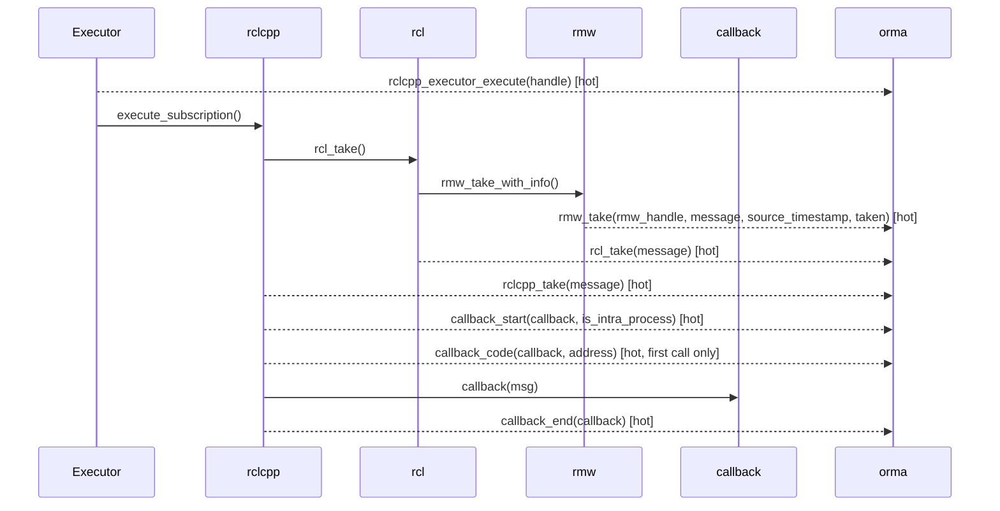

같은 토픽의 발행자 둘이 같은 source timestamp를 내면 잇지 않고 ambiguous로 센다. 다른 토픽의 메시지가 같은 nanosecond 값을 가질 수 있으므로 matching key에 토픽을 넣는다.

### 2.8 intra-process

intra-process 전달에는 rmw take가 없으므로 transport latency와 take 빈도를 측정 불가능하다. orma는 `callback_start`의 `is_intra_process`로 전달 경로를 구별하고, 발행 빈도는 `rclcpp_intra_publish`로 표시한다.

연결 관계는 rclcpp C++ 함수에서 읽는다.

| orma 이벤트 | rclcpp 함수 | 주는 것 |
| --- | --- | --- |
| `rclcpp_publisher_setup_intra` | `PublisherBase::setup_intra_process` | intra 발행자 id -> rcl 핸들 |
| `rclcpp_subscription_setup_intra` | `SubscriptionBase::setup_intra_process` | intra 구독 id -> rclcpp 구독 |
| `rclcpp_ipm_insert_sub_id_for_pub` | `IntraProcessManager::insert_sub_id_for_pub` | 프로세스 안 발행자 -> 구독 |

intra-process 버퍼 tracepoint(`rclcpp_ring_buffer_*`, `rclcpp_buffer_to_ipb`, `rclcpp_ipb_to_subscription`)는 수집하지 않는다.

rcl broker(`RCL_INTRA_PROCESS=1`)는 rclcpp `IntraProcessManager`와 다른 경로다. take가 있으므로 transport latency와 take 빈도를 잰다(2.13).

### 2.9 타이머와 서비스 콜백

타이머와 서비스 콜백도 `callback_start`와 `callback_end` 사이로 잰다. 콜백 객체는 2.3의 `*_callback_added`가 타이머나 서비스에 연결한 객체다.

- 타이머: 예상 빈도는 `rcl_timer_init`의 period에서 온다. `orma node cb`의 `expected` 열이다.
- 서비스: request와 response latency는 재지 않고, 서비스 콜백 duration만 산출한다. rmw client, service tracepoint(`rmw_client_init`, `rmw_send_request`, `rmw_take_request`, `rmw_send_response`, `rmw_take_response`)는 Kilted부터 있고 Humble, Jazzy에는 없다.

### 2.10 rclpy

rclpy는 `ros_trace_*`를 직접 호출하지 않는다. rcl과 rmw를 거치는 이벤트(init, `rcl_publish`, `rmw_publish`, `rmw_take`, `rcl_wait`)는 Python 노드에서도 나오지만, 등록과 콜백 이벤트는 나오지 않는다. 그 빈칸은 `orma_rclpy`가 채운다. `orma_rclpy`는 C++ 노드와 같은 `libtracetools.so`의 `ros_trace_*`를 호출하므로, 세 method가 C++ 노드와 똑같이 받는다.

| 이벤트 | rclpy에서 나오는가 | `orma_rclpy`가 하는 일 |
| --- | --- | --- |
| `rcl_*_init`, `rcl_publish`, `rmw_publish`, `rmw_take`, `rcl_wait` | 나온다 | - |
| `rclcpp_subscription_init`, `rclcpp_subscription_callback_added` | 나오지 않는다 | 구독 생성 시 호출한다. rclcpp 구독 객체 자리에 Python `Subscription` 객체 주소를 넣는다 |
| `rclcpp_service_callback_added` | 나오지 않는다 | 서비스 생성 시 호출한다 |
| `rclcpp_timer_callback_added`, `rclcpp_timer_link_node` | 나오지 않는다 | 타이머 생성 시 호출한다 |
| `rclcpp_callback_register` | 나오지 않는다 | 콜백의 `__qualname__`을 넘겨 호출한다. 이 이름에는 gate가 없어 `uprobe` 방식도 받는다 |
| `rclcpp_executor_*` | 나오지 않는다 | 호출하지 않는다. 깨어남은 `rcl_wait` return으로 잰다 |
| `callback_start`, `callback_end` | 나오지 않는다 | 엔티티의 `callback` 속성을 감싼 함수가 콜백 앞뒤에서 호출한다 |

- 감싸는 함수: `rclpy.node.Node`의 `create_subscription`, `create_service`, `create_timer`
- 모듈은 프로세스 시작 시 로드된다(`orma run`, `OrmaTrace`가 `PYTHONPATH`에 추가한다). 이미 실행 중인 Python 노드는 다시 시작해야 하고, `uprobe` 방식도 마찬가지다.
- user site가 비활성화된 프로세스(가상환경, `python3 -s`, `-I`)에서는 로드되지 않는다.
- 사용자가 `callback` 속성을 다시 바꾼 엔티티에서는 `callback_*`이 나오지 않는다(예: `create_rate`의 타이머).
- coroutine 콜백은 `await`로 멈춘 시간도 콜백 duration에 들어간다.

### 2.11 late attach

orma가 엔티티보다 늦게 부착하면 2.1-2.3의 이벤트가 없어 콜백의 노드를 모른다. rcl과 rmw 핸들에는 노드를 가리키는 값이 없고, 노드는 rclcpp 객체에만 있다. 그래서 `uprobe` 방식은 executor가 콜백을 실행하는 함수에서 노드를 읽는다.

```text
Executor::execute_any_executable(AnyExecutable &)   uprobe, probe set names
  AnyExecutable.subscription -> SubscriptionBase -> node_handle_ -> rcl_node_t -> impl -> fq_name
  AnyExecutable.service      -> ServiceBase      -> node_handle_ -> ...
  AnyExecutable.timer        -> (no node) callback_group -> first subscription, service or client's node_handle_
callback_start(callback)      same thread, one level deep -> rclcpp_callback_owner (once per callback)
```

- `rclcpp_callback_owner` 이벤트는 콜백, 그 엔티티, rcl 핸들, 노드 핸들, 종류, 노드 FQN을 싣는다. orma-collectd는 놓친 init 이벤트 대신 이것을 사용한다.
- 이 uprobe는 콜백마다 호출된다(Orin에서 약 1.25 us). 그래서 probe set `names`는 노드를 모르는 콜백이 처음 실행된 지 10 s 안인 프로세스에만 부착하고, 노드를 알면 뗀다. 10 s 안에 찾지 못해도 뗀다.
- 구독의 토픽은 `rmw_subscription_topic`(2.7)에서 온다. 서비스 이름은 읽지 않으므로, late attach한 서비스 콜백은 `srv`와 함수 이름만 표시된다.
- 타이머는 노드를 갖지 않으므로 그 콜백 그룹의 첫 구독, 서비스, 클라이언트의 노드를 사용한다. 타이머만 있는 그룹의 타이머는 노드를 모른 채 남는다.
- `execute_any_executable`을 거치지 않는 executor(Humble의 `StaticSingleThreadedExecutor`, `EventsExecutor`), intra-process로만 받는 구독, rclpy는 보이지 않는다. 이들은 `orma node` 명령의 node 열에 `unlinked`로 남는다.

### 2.12 rcl_executor

executor core `rcl_executor`(`librcl_executor.so`)는 `rcl_wait`를 호출하지 않는다. 그 위의 `rclcpp::experimental::executors::RclExecutor`와 `rclpy.experimental.RclExecutor`는 `Executor::execute_any_executable`도 거치지 않는다. 그래서 2.5의 `rcl_wait_*`, `rclcpp_executor_get_next_ready`, `rclcpp_executor_wait_for_work`, `rclcpp_executor_execute`가 나오지 않는다. 콜백, take, 발행 이벤트는 그대로 나온다. core는 uprobe용 빈 함수 넷(`rcl_executor/trace.h`의 `rcl_executor_trace_*`)을 export하고, orma는 uprobe method에서 그 함수에 부착한다.

probe 선택:

- 프로세스마다 매핑한 파일로 정한다. `librcl_executor.so`가 매핑되어 있고 그 파일이 anchor 넷을 모두 export하면 rcl_executor probe를 `hot` set에 추가한다. 버전이나 환경변수는 보지 않는다
- anchor가 하나라도 없는 `librcl_executor.so`는 거절하고 `probes_missing`에 남긴다
- 한 프로세스에 stock executor와 `RclExecutor`가 공존 가능하므로, stock probe(`rcl_wait`, rclcpp executor tracepoint)는 그대로 부착한다
- core를 매핑하지 않은 프로세스에는 아무것도 추가로 부착하지 않으므로, stock ROS 2 프로세스의 비용은 그대로다
- 확인: `orma status`의 `executor probes:` 줄(`stock`, `rcl_executor`), `orma check`의 `executor probes pid N` 행

| core 함수 | orma 이벤트 | 인자 | 같은 뜻의 stock 지점 |
| --- | --- | --- | --- |
| `rcl_executor_trace_wait_enter(executor, timeout_ns)` | `rcl_wait_enter`, flag `ORMA_RECORD_RCL_EXECUTOR` | `wait_set` = executor, `timeout` = timeout_ns | `rcl_wait` entry |
| `rcl_executor_trace_wait_exit(executor, result)` | `rcl_wait_exit`, flag `ORMA_RECORD_RCL_EXECUTOR` | `wait_set` = executor, `ret` = `rcl_executor_result_t` | `rcl_wait` return |
| `rcl_executor_next_excluding` entry | 없음. 스레드별로 `rcl_executor_item_t *`만 기억한다 | - | - |
| `rcl_executor_trace_item_claimed(executor, id, type, group)` | `rcl_executor_claim` | executor, registration, entity, context, group, entity_type, rclcpp | `rclcpp_executor_execute`(dispatch 시작) |
| `rcl_executor_trace_item_completed(executor, id)` | `rcl_executor_complete` | executor, registration | 없음 |

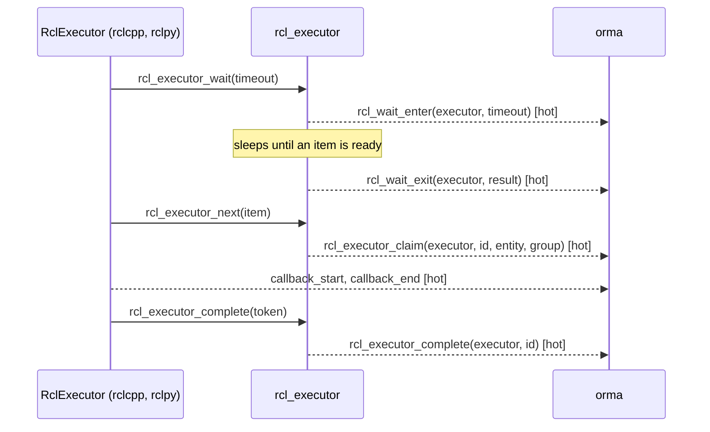

이벤트를 고른 규칙:

- 대기 이벤트 둘은 stock 이벤트 번호와 페이로드를 그대로 사용하고, record header의 flag `ORMA_RECORD_RCL_EXECUTOR`(2)로만 구별한다. 그래서 wait time, wakeup latency, dispatch latency는 분기 없이 같은 식으로 계산된다(6절)
- core 대기의 key는 wait set 대신 executor(`rcl_executor_t *`)다. `ret`는 `rcl_ret_t`가 아니라 `rcl_executor_result_t`(0 `READY`, 1 `TIMEOUT`, 2 `INTERRUPTED`, 3 `STOPPED`, 4 `ERROR`)다
- claim은 새 이벤트다. `rclcpp_executor_execute`는 rclcpp만 호출하는 tracepoint이고 rcl 핸들 하나만 싣는다. core는 언어와 무관하고, claim과 complete를 잇는 데 registration id가 필요하다
- orma-collectd는 `rclcpp`가 1인 claim을 `rclcpp_executor_execute`와 같은 dispatch 시작으로 읽고, `rclcpp`가 0인 claim은 stock rclpy처럼 executor 이벤트 없이 둔다. 그래서 executor 종류(`rclcpp`, `rclpy`)가 stock과 같은 규칙으로 정해진다
- `rclcpp`는 ormad가 그 프로세스의 `librclcpp.so` 매핑 여부로 채운다. rclcpp를 사용하는 C++ extension을 로드한 Python 프로세스는 `rclcpp`로 표시된다
- complete는 stock에 없다. claim부터 complete까지가 core가 본 item 실행 시간이다. coroutine 콜백이면 콜백보다 길다

claim의 값과 같은 값을 싣는 다른 이벤트:

| 값 | rclcpp `RclExecutor` | rclpy `RclExecutor` | 같은 값을 싣는 이벤트 |
| --- | --- | --- | --- |
| `registration` | core가 매긴 순번(`rcl_executor_add`의 출력) | rclcpp `RclExecutor`와 같다 | `rcl_executor_complete` |
| `entity` | `rcl_subscription_t *`, `rcl_timer_t *`, `rcl_service_t *`, `rcl_client_t *`. waitable(`RCL_EXECUTOR_WORK`)은 0 | `rcl_*_t *`(event, guard condition 포함) | `rcl_subscription_init`, `rcl_timer_init`, `rcl_service_init`, `rcl_client_init`의 핸들. 서비스와 타이머는 `rclcpp_*_callback_added`의 핸들도 |
| `context` | `SubscriptionBase *`, `ServiceBase *`, `ClientBase *`, `TimerBase *`, `Waitable *` | 엔티티 객체의 `id()` | 구독은 `rclcpp_subscription_init`의 subscription(rclpy는 `orma_rclpy`가 같은 `id()`를 넣는다) |
| `group` | `CallbackGroup *` | 콜백 그룹의 `id()` | `rclcpp_group_add_subscription`, `rclcpp_group_add_timer`의 group |

엔티티 읽기:

- anchor는 core만 아는 registration id만 넘기고 엔티티는 넘기지 않으므로, anchor만으로는 다른 이벤트와 연결 불가능하다
- 그래서 `rcl_executor_next_excluding`(`rcl_executor_next`가 넘어가는 곳) 입구에서 `rcl_executor_item_t *`를 스레드별로 기억하고, claim anchor에서 `item->entity`(offset 24)와 `item->context`(offset 32)를 읽는다. anchor 호출 시점에 item은 이미 채워져 있다
- `item->registration`(offset 0)이 anchor의 id와 다르면 읽지 않고 0으로 설정한다. 같은 스레드의 이전 호출이 남긴 item을 읽지 않기 위해서다
- item 하나에 core 쪽 uprobe가 다섯 번 호출된다(대기 둘, next, claim, complete). 모두 entry probe이고 uretprobe는 없다

차이와 빈칸:

- `rcl_executor_spin`은 claim마다 먼저 대기를 호출한다. ready인 item이 있으면 바로 `READY`로 반환하므로 길이가 0에 가까운 대기가 섞인다
- rclcpp `RclExecutor`가 `RCL_EXECUTOR_WAIT_SET` policy로 waitable을 실행하면 그 안에서 `rcl_wait(ws, 0)`를 호출한다. 이 호출은 stock `rcl_wait_*`로 수집되고, 그 뒤 콜백의 dispatch latency는 이 호출의 return부터 잰다
- `preload`, `lttng` 방식은 anchor를 가로채지 않으므로, 그 방식으로 실행한 `RclExecutor` 프로세스에는 대기와 claim이 없다
- late attach(2.11)의 노드 읽기는 `execute_any_executable`에 부착하므로 `RclExecutor`에서는 동작하지 않는다. 그런 콜백은 `unlinked`로 남는다

### 2.13 전달 경로

rcl broker가 있는 ROS 2에서는 같은 토픽의 메시지도 구독마다 다른 경로로 전달된다. orma는 take마다 경로를 기록하고, 경로별 take 수와 transport latency, take에서 콜백까지, rclpy 변환, 버퍼 보유 시간을 산출한다.

| 경로 | 뜻 | 조건 |
| --- | --- | --- |
| `broker` | rcl broker가 rmw를 거치지 않고 같은 프로세스의 reader에게 넘긴 메시지 | broker가 있는 rcl, `RCL_INTRA_PROCESS=1` |
| `loan` | 발행자가 rmw loan을 빌려 발행한 메시지 | `borrow_loaned_message`를 사용하는 발행자, loan을 지원하는 rmw |
| `shm` | rmw_zenoh가 zenoh 공유 메모리에 직렬화한 페이로드 | rmw_zenoh, SHM 활성화, 메시지가 SHM threshold 이상 |
| `net` | rmw가 자기 버퍼에 직렬화한 페이로드 | 위 셋이 아닌 rmw 발행 |
| `unknown` | 발행을 보지 못한 take | 발행자 프로세스를 관측하지 않는 경우 |

probe 선택:

- 프로세스마다 매핑한 파일의 export로 정한다. 2.12와 같은 규칙이고, 버전이나 환경변수는 보지 않는다
- stock Jazzy 프로세스에는 stock 라이브러리의 export 함수인 `loan`과 `zenoh_shm`만 부착한다
- 확인: `orma status`의 `delivery probes:` 줄
- loan 반납은 rmw 함수에서 수집한다. rcl의 반납 함수도 그 함수를 호출하고, rclpy는 구독 loan을 rmw 함수로 바로 반납한다
- rcl과 rclpy가 anchor를 PLT로 호출하므로 `preload`, `lttng` 방식도 같은 지점을 가로챈다. 2.12의 core anchor와 다른 점이다

| probe | 부착 조건 | 부착하는 함수 |
| --- | --- | --- |
| `broker` | `librcl.so`가 `rcl_ipc_trace_contract_1`을 export | `rcl_ipc_trace_publish`, `rcl_ipc_trace_take`, `rcl_ipc_trace_release` |
| `loan` | `librcl.so`가 `rcl_borrow_loaned_message`를 export | `librcl.so`의 `rcl_borrow_loaned_message`(entry, return), `rcl_publish_loaned_message`, `rcl_take_loaned_message`, `librmw_implementation.so`의 `rmw_return_loaned_message_from_publisher`, `rmw_return_loaned_message_from_subscription` |
| `zenoh_shm` | `libzenohc.so`가 `z_bytes_from_shm_mut`을 export | `z_bytes_from_shm_mut` |
| `rclpy` | `_rclpy_pybind11.*.so`가 `rclpy_trace_contract_1`을 export | `rclpy_trace_take_converted`, `rclpy_trace_publish_enter` |

| 함수 | orma 이벤트 | 인자와 뜻 |
| --- | --- | --- |
| `rcl_ipc_trace_publish(publisher, message, source_timestamp, readers)` | `rcl_ipc_publish` | broker가 같은 프로세스 reader `readers`개에 넣은 메시지. reader가 없으면 호출되지 않는다 |
| `rcl_ipc_trace_take(subscription, message, data, source_timestamp, local)` | `rcl_ipc_take` | reader의 take. 아래 목록 참고 |
| `rcl_ipc_trace_release(message)` | `rcl_ipc_release` | take한 메시지의 release |
| `rcl_borrow_loaned_message` return | `rcl_loan_borrow` | 발행자, 빌린 loan, `rcl_ret_t` |
| `rcl_publish_loaned_message` | `rcl_loan_publish` | 발행자, loan |
| `rmw_return_loaned_message_from_publisher` | `rmw_loan_return` | rmw 발행자, loan |
| `rcl_take_loaned_message` | `rcl_loan_take` | 구독. loan은 그 안의 `rmw_take`가 싣는다 |
| `rmw_return_loaned_message_from_subscription` | `rmw_loan_return` | rmw 구독, loan |
| `z_bytes_from_shm_mut(bytes, shm)` | `zenoh_shm_payload` | bytes 객체 |
| `rclpy_trace_publish_enter(publisher)` | `rclpy_publish_enter` | Python 메시지 변환 전, rclpy 발행 시작(loan 발행 포함) |
| `rclpy_trace_take_converted(subscription, message)` | `rclpy_take_converted` | take한 메시지의 Python 변환 끝 |

`rcl_ipc_take`의 인자:

- `message`는 release 시까지 점유하는 `rcl_ipc_message_t *`이고, 복사로 꺼냈으면 0이다.
- `local`이 0이면 rmw가 broker에 넣은 다른 프로세스의 메시지다.

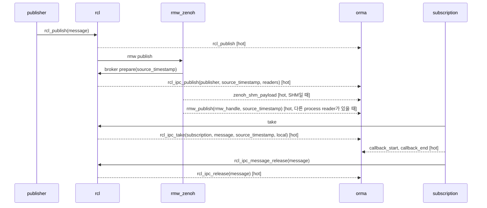

경로 판정:

- `broker`: `local`이 1인 `rcl_ipc_take`. 모든 reader가 broker reader면 rmw_zenoh가 `rmw_publish`를 호출하지 않으므로, 발행 쪽 key는 `rcl_ipc_publish`의 `(topic, source timestamp)`다
- 그 밖의 take는 짝지은 발행의 경로를 받는다. 발행 경로는 같은 스레드에서 `rcl_publish`부터 `rmw_publish`까지 본 이벤트로 정한다. `rcl_loan_publish`가 있으면 `loan`, `zenoh_shm_payload`가 있으면 `shm`, 둘 다 없으면 `net`이다
- 한 발행이 broker reader와 다른 프로세스 reader를 함께 가지면, 같은 source timestamp의 take가 reader마다 다른 경로로 수집된다
- 경로별 값은 `orma topic path`(사용법 4절)와 window의 `paths`에 있다. 경로별 hop 표본 수의 합은 토픽과 구독의 hop 표본 수와 같다

구간:

| 구간 | 정의 |
| --- | --- |
| hop by path | 경로별 transport latency. take - 발행(`rmw_publish` 또는 `rcl_ipc_publish`) |
| take -> callback start | take(`rmw_take`, `rcl_ipc_take`) - 그 take의 `callback_start` |
| rclpy take -> converted | `rclpy_take_converted` - 같은 스레드의 마지막 take. take -> callback start의 일부 |
| rclpy publish -> rcl | `rcl_publish` - `rclpy_publish_enter`. Python 메시지에서 C 메시지로의 변환 |
| subscription hold | `rcl_ipc_release` 또는 구독의 `rmw_loan_return` - take. broker 메시지나 loan을 점유한 시간 |
| publisher loan hold | `rcl_loan_publish` 또는 발행자의 `rmw_loan_return` - `rcl_loan_borrow` |

anchor를 둔 이유:

broker가 있는 rcl과 그 rcl에 맞춘 rclpy에는 uprobe용 빈 함수(anchor)가 있다. 2.12의 core anchor와 같은 방식이고, 인자를 바꾸면 contract 심볼 번호를 올린다. stock 함수로 수집 가능한 지점(`loan`, `zenoh_shm`)에는 anchor가 없다.

| 지점 | stock 함수로 수집 불가능한 이유 |
| --- | --- |
| broker 발행 | broker만 받는 발행에는 `rmw_publish`가 없고, source timestamp는 rmw_zenoh가 만들어 rcl 안의 내부 함수(broker의 prepare)로만 넘긴다 |
| broker take | take 함수가 셋(`rcl_take_ipc_message`, `rcl_take_ipc_adapted`, `rcl_ipc_take_serialized_copy`)이고 source timestamp와 메시지는 출력 인자라, uprobe로는 함수마다 entry와 return 두 probe가 필요하다. anchor는 entry probe 하나다 |
| broker release | `rcl_ipc_take_copy`가 내부에서 메시지를 지운다. anchor는 그 경로도 release로 센다 |
| rclpy 변환 | `_rclpy_pybind11`은 심볼을 숨기고, take는 Python executor 외에 C++ executor(`EventsExecutor`, `RclExecutor`)에서도 호출되어 Python 쪽에서 감쌀 곳이 없다 |

차이와 빈칸:

- rmw_zenoh는 SHM provider를 첫 SHM 발행 시 만든다. 그 전의 메시지 몇 개는 `net`으로 수집된다
- `shm`은 발행자가 SHM 페이로드를 만들었다는 뜻이다. 구독자가 SHM을 매핑하지 못해 받는 쪽에서 복사했는지는 보지 않는다
- `rcl_take_loaned_message`는 entry만 본다. take에 실패한 호출 뒤 같은 스레드의 다음 take가 loan으로 수집될 가능성이 있다
- `rcl_take`가 broker 메시지를 사용자 메시지로 복사하는 경로(`rcl_ipc_take_copy`)는 take 직후 release하므로 hold가 0에 가깝다
- `rclpy` probe는 anchor가 있는 rclpy에만 있다. stock rclpy의 변환 시간은 take -> callback start에 포함된다

## 3. flux 실행 흐름

flux는 `libflux_ffi.so`가 export하는 `flux_trace_*` 함수를 호출한다. 몸체가 비어 있고 enabled 검사가 없어, 세 수집 방식이 모두 함수 자체에 부착한다. 함수 이름과 인자가 계약이고, 버전은 아무것도 하지 않는 심볼 `flux_trace_contract_2`다. orma는 이 심볼을 export하는 라이브러리에만 부착한다. 버전이 다른 라이브러리는 인자가 다르므로 잘못 읽지 않도록 거절한다.

- 채널 id는 flux 채널 공유 상태의 주소이고, 재연결 전까지 바뀌지 않는다. executor id는 executor control block의 주소다.
- 문자열 인자는 255 B까지 읽는다.
- flux를 정적으로 링크한 프로그램은 함수를 직접 호출하므로 `preload`, `lttng`에 보이지 않는다.

### 3.1 채널과 엔드포인트 생성

수집하는 것:

- 채널 핸들, 세그먼트(device, inode, 이름), 발행자 여부, 슬롯 수와 크기, 페이로드 안 `header.stamp` 위치(`flux_channel_init`). 생성과 재연결 시 나온다
- 엔드포인트 핸들, 노드, key, signpost, fingerprint, role(발행자, 구독), 언어(C++, Python)(`flux_endpoint_init`). flux_cpp와 flux_py의 `Publisher`, `Subscription` 생성자에서 나온다

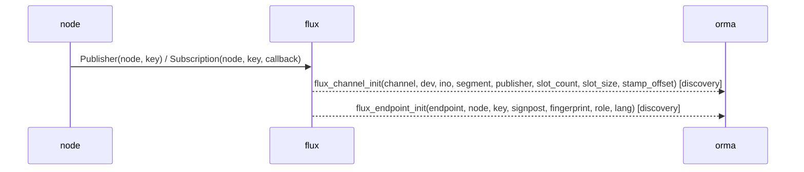

orma가 채널보다 늦게 부착하면 `flux_callback_end`가 싣는 세그먼트 이름으로 채널을 알아낸다. 콜백 이름은 그 채널의 signpost가 가진 key다.

### 3.2 발행

발행 경로는 둘이다. copy 경로는 슬롯을 claim하고 바로 commit한다. loan 경로는 슬롯을 사용자에게 loan하고, 사용자가 쓴 뒤 commit한다.

수집하는 것:

- 슬롯 claim 결과와 실패 이유(`flux_claim`). 실패하면 slot은 `UINT32_MAX`다
- loan 시작과 끝, 결과(`flux_loan`, `flux_loan_end`). commit에 성공하면 `loan_end`는 `commit` 다음에 나온다. 쓰지 않고 버린 loan은 abort로 끝난다
- 발행(`flux_commit`). ticket, slot, byte 수, 깨운 구독 수, `header.stamp`를 싣는다

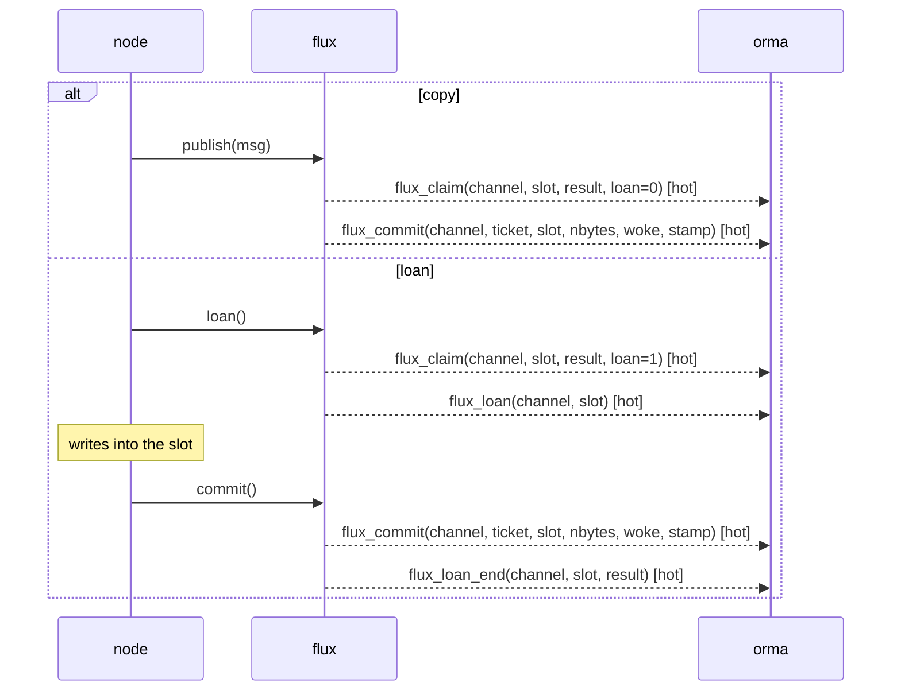

flux_bag recorder가 프레임을 bag에 쓰지 못하고 버리면 `flux_record_drop`이 나온다. orma는 이것을 기록 손실로 표시한다.

sticky CUDA error가 프로세스의 GPU를 멈추면 `flux_gpu_wedged(result)`가 프로세스마다 한 번 나온다. `result`는 그 `CUresult`다.

- 그 뒤 GPU 채널의 claim, loan, take는 `CLAIM_GPU_WEDGED`, `LOAN_GPU_WEDGED`, `REFUSED_GPU_WEDGED`로 실패하고, orma는 토픽의 publish drop으로 센다.
- `orma node cpu`는 그 프로세스에 경고 한 줄을 추가한다.
- ormad는 이 함수를 discovery set으로 모든 flux 프로세스에 부착한다. 이 함수가 없는 이전 flux build에서는 `probes_missing`에 남는다.

### 3.3 take와 콜백

flux executor는 wait word에서 잠들고, 발행자가 깨우면 콜백을 실행한다. `flux_wake`는 깨운 원인(source, control word, timeout, already ready)과 깨운 entry 번호를 싣는다. flux는 `EINTR`이면 남은 deadline으로 다시 기다린다. signal(`WAKE_SIGNAL`)은 이전 flux build만 낸다.

수집하는 것:

- 대기 시작(`flux_wait`). 기다리는 wait word의 수와 timeout을 싣는다
- 깨어남과 깨운 원인(`flux_wake`)
- 콜백 시작과 끝(`flux_callback_start`, `flux_callback_end`). 시작은 엔드포인트를, 끝은 delivered 여부, 채널, 세그먼트를 싣는다
- take(`flux_take`). ticket, slot, 놓친 프레임 수, `header.stamp`를 싣는다. 발행 쪽 `flux_commit`과 `(segment, ticket)`으로 짝짓는다
- borrow 거절과 이유(`flux_refused`)
- lease 끝(`flux_release`). `held`가 1이면 완료 신호 대기가 실패해 borrow를 점유한 채 남았다는 뜻이다
- Python: GIL 대기(`flux_py_gil`, phase 0과 1 사이)와 프레임을 Python 객체로 만든 시점(`flux_py_ready`). `py_ready`는 같은 `(channel, ticket)`의 `take`와 짝짓는다

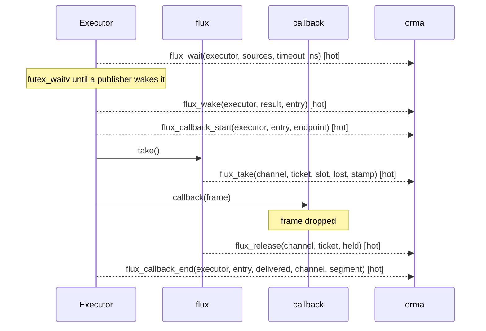

## 4. 스케줄링

orma는 스레드가 깨어난 시각(wakeup), CPU를 받은 시각(switch-in), CPU를 반납한 시각(switch-out)을 받는다. 커널 tracepoint `sched_switch`와 `sched_wakeup`을 eBPF로 받으므로 ormad가 필요하고, 수집 방식과는 관계없다. 대상 스레드만 커널 안에서 거른다.

용도는 둘이다.

- scheduling latency: switch-in 시각 - wakeup 시각
- 콜백 안 off-CPU time: 콜백 시작과 끝 사이에 스레드가 CPU를 반납한 시간. ormad는 그 스레드가 어느 콜백 안에 있는지 알아야 한다. `uprobe` 방식에서는 eBPF 프로그램이 콜백 stack을 갖고 있고, `preload`와 `lttng`에서는 스레드마다 실행 중인 콜백을 공유 메모리 파일에 적고 ormad가 그 파일을 읽는다

orma는 콜백 안 on-CPU time(callback duration - 콜백 안 off-CPU time)을 기준으로 CPU를 노드에 나눈다. DDS와 SDK 스레드처럼 콜백 밖에서 실행되는 몫은 프로세스 공용 몫으로 따로 표시한다. `sched`가 없으면 콜백 wall time으로 계산한 상한을 사용하고, `orma node cpu`의 CPU source 열이 `wall_bound`가 된다.

## 5. 추가 수집

span은 항상 수집한다. 나머지는 클라이언트가 활성화한 경우에만 부착한다(`--gpu`, `--dds`, `--futex`, rqt의 Selection tab). 이벤트마다 스레드와 시각이 있고, orma-collectd는 이 값으로 이벤트를 그 스레드에서 실행 중인 콜백에 연결한다.

### 5.1 span

span은 사용자가 코드에 표시한 구간이다. `liborma_span.so`의 `orma_span_begin(name)`, `orma_span_end(name)`은 몸체가 빈 함수다. C++ `orma::Span`과 Python decorator `orma_span.span`도 이 둘을 호출한다.

수집하는 것:

- span 시작(`span_begin`). 이름 문자열의 주소(key)와 이름. 이름은 begin에서만 읽는다
- span 끝(`span_end`). key

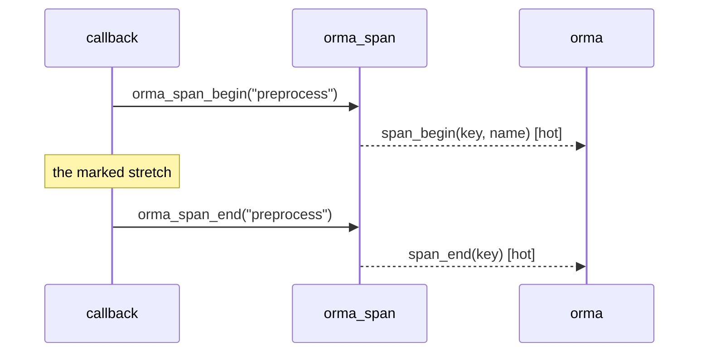

- begin과 end는 같은 스레드에서 key로 짝짓는다. 짝 없는 end는 버린다
- span 안의 span은 감싼 span에, 콜백 안의 span은 감싼 콜백에 속한다
- 이름은 정적 수명의 문자열이어야 한다. 주소가 다르면 begin과 end가 이어지지 않는다

### 5.2 CUDA driver 호출

`libcuda.so`의 driver 함수 entry와 return을 수집한다. 호출 하나가 레코드 하나다.

| 종류 | 함수 |
| --- | --- |
| launch | kernel launch, graph launch |
| copy | 동기 copy, 비동기 copy(`_v2` 이름과 `_ptds`/`_ptsz` 변형). byte 수는 인자에서 읽고, 2D, 3D copy는 width x height(x depth)다 |
| synchronize | stream, context, event synchronize |
| memory | 할당, 해제 |

수집하는 것(`cuda_call`): 호출 시간, byte 수, 종류, `CUresult`

- 재는 것은 호스트 쪽 호출 시간이고, GPU 안의 커널 실행 시간은 재지 않는다. 비동기 launch는 바로 반환하므로 기다린 시간은 synchronize와 동기 copy에 나타난다
- cudart는 libcuda를 자기 핸들의 `dlsym`과 `cuGetProcAddress`로 얻는다. `preload`와 `lttng`은 이 둘도 가로채 자기 CUDA 함수를 넘기므로, cudart를 정적으로 링크한 프로그램(nvcc 기본)도 수집된다. `uprobe`는 함수 주소에 부착하므로 경로와 무관하다
- ormad는 Jetson의 `nvidia/`, `tegra/` 아래 `libcuda.so`에도 부착한다
- orma는 CUDA toolkit 없이 빌드한다. 시간을 재는 함수의 prototype은 `orma_preload`의 `cuda_api.h`에 있다

### 5.3 DDS write

DDS write 함수의 entry와 return을 수집한다. 호출 하나가 레코드 하나다.

| DDS | 함수 |
| --- | --- |
| Cyclone DDS(`libddsc.so`) | `dds_write`, `dds_write_ts`, `dds_writecdr`, `dds_forwardcdr` |
| Fast DDS(`libfastrtps.so` 2.x, `libfastdds.so` 3.x) | `DataWriter::write` overload |

수집하는 것(`dds_write`): writer, 호출 시간

- orma-collectd는 write를 같은 스레드에서 진행 중인 `rcl_publish`와 짝지어 토픽을 연결한다. 짝이 없는 write는 버린다
- 구간 두 개를 산출한다(6절): 발행에서 DDS write 시작까지, DDS write 호출에 걸린 시간

### 5.4 futex 대기

커널 tracepoint `syscalls:sys_enter_futex`/`sys_exit_futex`와 `futex_waitv` 쌍을 eBPF로 받는다. ormad가 필요하고 수집 방식과는 관계없다. 대상 스레드만 커널 안에서 거른다.

- 대상: 대기 command(`FUTEX_WAIT`, `FUTEX_WAIT_BITSET`, `FUTEX_LOCK_PI`, `FUTEX_LOCK_PI2`, `FUTEX_WAIT_REQUEUE_PI`)와 `futex_waitv`
- 수집하는 것(`futex_wait`, return 시): 주소, 대기 시간, command, 반환값
- 콜백 안 대기: 콜백 시작 전에 시작한 대기는 콜백 시작부터 센다

## 6. 지연 구간

ROS 토픽과 flux 채널을 같은 구간으로 잰다.

| 이벤트 | ROS | flux |
| --- | --- | --- |
| 발행 | `rmw_publish`, broker만 받는 발행은 `rcl_ipc_publish`(2.13) | `flux_commit` |
| matching key | `(topic, source timestamp)` | `(segment, ticket)` |
| take | `rmw_take`(`taken`이 참), `rcl_ipc_take` | `flux_take` |
| 대기 시작 | `rcl_wait` entry, `rcl_executor_trace_wait_enter`(2.12) | `flux_wait` |
| 깨어남 | `rcl_wait` return, `rcl_executor_trace_wait_exit` | `flux_wake` |
| dispatch 시작 | `rclcpp_executor_execute`, `rcl_executor_claim` | - |
| 콜백 | `callback_start` -> `callback_end` | `flux_callback_start` -> `flux_callback_end` |

| 구간 | 정의 |
| --- | --- |
| transport latency | take - 발행(같은 메시지) |
| wait time | 깨어남 - 대기 시작(같은 스레드) |
| wakeup latency | 깨어남 - 발행 |
| dispatch latency | 콜백 시작 - 깨어남 |
| callback duration | 콜백 끝 - 콜백 시작 |
| callback on-CPU time | callback duration - 콜백 안 off-CPU time |
| scheduling latency | switch-in - wakeup(4절) |
| pub to dds | DDS write 시작 - `rclcpp_publish`(없으면 `rcl_publish`), 같은 스레드(5.3) |
| dds write | DDS write 호출 시간(5.3) |
| span duration | `span_end` - `span_begin`(5.1) |
| 전달 경로별 구간 | hop by path, take -> callback start, rclpy 변환, hold(2.13) |

- 프로세스 안 구간(callback duration, dispatch latency)은 수집 지점에서 집계한다. `lttng`만 orma-collectd에서 집계한다.
- 프로세스 사이 구간(transport latency, wakeup latency)은 orma-collectd가 짝지어 산출한다.
- `orma analyze`는 기록을 이 구간으로 나눈다.

## 7. distro 차이

한 호스트에 Jazzy 프로세스와 Humble 컨테이너가 공존 가능하므로, orma는 프로세스마다 distro를 판정한다. 판정은 `/proc/<pid>/environ`의 `ROS_DISTRO`로 하고, 없으면 매핑된 `libtracetools.so`의 경로(`/opt/ros/<distro>/`)로 한다. 파일은 모두 `/proc/<pid>/root`를 거쳐 접근하므로 컨테이너 안의 라이브러리도 그 컨테이너의 파일로 판정한다.

| 항목 | Humble | Jazzy |
| --- | --- | --- |
| `libtracetools.so`의 LTTng | X. `lttng` 방식에서는 `liborma_lttng.so`의 `ros2` provider가 대신 이벤트를 만든다 | O |
| `rclcpp_callback_register` | gate가 없다. 이름 문자열이 빌 가능성이 있어 `callback_code`로 채운다 | gated(1절) |
| 발행 ABI | rcl: `ros_trace_rmw_publish(message)`(orma 이벤트 `rmw_publish_rcl`). 발행자 key는 `rcl_publish`의 rcl 핸들 | rmw: `ros_trace_rmw_publish(rmw_handle, message, timestamp)` |
| transport latency | take 시각 - source timestamp(wall clock). 발행 쪽 시각이 없어 짝짓기가 불가능하고, 같은 호스트에서만 맞는 값이다 | 짝지은 monotonic 시각의 차 |
| `rclcpp_intra_publish` | X. intra-process로만 오가는 토픽은 행이 생기지 않는다 | O |
| executor 소속 | `Executor::add_callback_group_to_map`(`rclcpp_executor_add_group`) | `ExecutorEntitiesCollector` 함수 |
| rmw client, service tracepoint | X(orma 미부착) | X(orma 미부착) |

## 8. 수집 방식별 범위

| 항목 | `uprobe` | `preload` | `lttng` |
| --- | --- | --- | --- |
| 부착 시점 | 실행 중인 프로세스 | 프로세스 시작 | 프로세스 시작 |
| ROS tracepoint | gated tracepoint를 제외한 전부 | 전부 | 전부 |
| 콜백 함수 이름 | `callback_code` | `rclcpp_callback_register` | `rclcpp_callback_register` |
| `rcl_wait`, `rcl_timer_fini`, rclcpp C++ 함수 | O | O | O |
| rcl_executor anchor(2.12) | O | X | X |
| 전달 경로 probe(2.13) | O | O | O |
| late attach인 경우 토픽과 노드(2.11) | O | -(시작부터 부착) | - |
| DDS serialized size | opt-in | 이 uprobe 추가 필요 | 이 uprobe 추가 필요 |
| `header.stamp`, `/clock` | O | O | O |
| flux 이벤트 | O | O | O |
| span | O | O | O |
| CUDA driver 호출(opt-in) | O | O | O |
| DDS write(opt-in) | O | O | O |
| futex 대기(opt-in) | ormad | ormad | ormad |
| 콜백 안 CPU, scheduling latency | ormad | ormad가 있는 경우 | ormad가 있는 경우 |
| malloc attribution(opt-in) | X | O | X |
| 권한 | ormad | 불필요 | 사용자 session daemon |

`liborma_preload.so`와 `liborma_lttng.so`는 함께 사용 가능하다. 둘 다 원래 함수를 `dlsym(RTLD_NEXT)`로 호출하므로, 호출은 앞의 라이브러리가 먼저 받아 뒤의 라이브러리로 넘기고, 마지막에 원래 함수(uprobe가 부착되는 곳)가 호출된다.

## 9. 한계

orma는 ROS 2를 고치지 않는다. 그래서 한계마다 우회 방법을 두거나 빈칸을 그대로 받아들였다.

| 한계 | 결과 | 대응 |
| --- | --- | --- |
| gated tracepoint(1절) | uprobe는 콜백 함수 이름과 zenoh 발행자 gid를 수신 불가능하다 | 함수 이름은 `callback_code`로 채운다. 측정값은 같다 |
| rclpy는 콜백 이벤트를 내지 않는다 | Python callback duration과 소속이 없다 | `orma_rclpy`(2.10). 이미 실행 중인 Python 노드는 재시작해야 한다 |
| Humble, Jazzy에는 rmw client, service tracepoint가 없다 | 서비스 request와 response latency를 측정 불가능하다 | 서비스 콜백 duration만 산출한다 |
| 발행과 take를 잇는 값은 source timestamp뿐이다 | source timestamp만으로 짝지으면 다른 토픽의 메시지가 섞인다 | matching key에 토픽을 넣고, 같은 토픽에서 겹치면 ambiguous로 센다 |
| intra-process 전달에는 take가 없다 | transport latency와 take 빈도가 없다 | `is_intra_process`로 경로를 구별하고 발행 빈도를 표시한다(2.8) |
| executor와 콜백 그룹 소속에는 tracepoint가 없다 | 소속 없이는 대기와 무거운 콜백을 구별 불가능하다 | rclcpp C++ 함수에서 읽는다(2.4). inline된 함수는 보이지 않는다 |
| DDS 스레드와 heap은 프로세스의 노드 전부가 공유한다 | 노드에 나눌 근거가 없다 | 프로세스 공용 몫으로 따로 표시한다 |
| 메모리는 address space 단위다 | 노드별 메모리가 없다 | 프로세스 RSS, PSS만 산출한다. 콜백별 malloc attribution은 `preload`의 opt-in이다 |
| serialized size는 rmw 내부 함수에만 있다 | `preload`, `lttng`로는 bandwidth를 확인 불가능하다 | uprobe opt-in으로만 잰다 |
| late attach하면 init과 등록 이벤트를 놓친다 | 이름과 소속이 빈다 | 토픽은 rmw 핸들에서, 노드는 executor에서 읽는다(2.11). 찾지 못한 것은 `unlinked`로 남긴다 |
| orma는 메시지 타입을 모른다 | `header.stamp` 위치를 모른다 | 앞 8 B를 읽고 clock 검사를 통과한 값만 사용한다(2.6) |
| `EventsExecutor`는 `rcl_wait`를 사용하지 않는다 | 대기와 깨어남이 없다 | 그 칸을 비운다 |
| `RclExecutor`는 `rcl_wait`와 rclcpp executor tracepoint를 사용하지 않는다 | stock probe로는 대기, 깨어남, dispatch 시작이 없다 | core의 anchor에 부착하고, 엔티티는 `rcl_executor_next_excluding`에서 item을 읽어 얻는다(2.12) |
| rcl broker만 받는 발행에는 `rmw_publish`가 없다 | stock 지점으로는 broker 전달의 발행과 경로가 없다 | rcl과 rclpy의 anchor에 부착한다(2.13) |
| CUDA는 호스트 쪽 호출만 보인다 | GPU 안의 커널 실행 시간이 없다 | synchronize와 동기 copy의 대기 시간으로 본다(5.2) |
